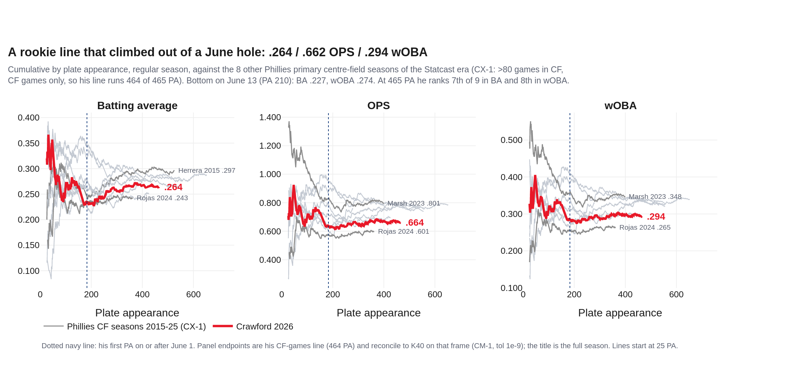
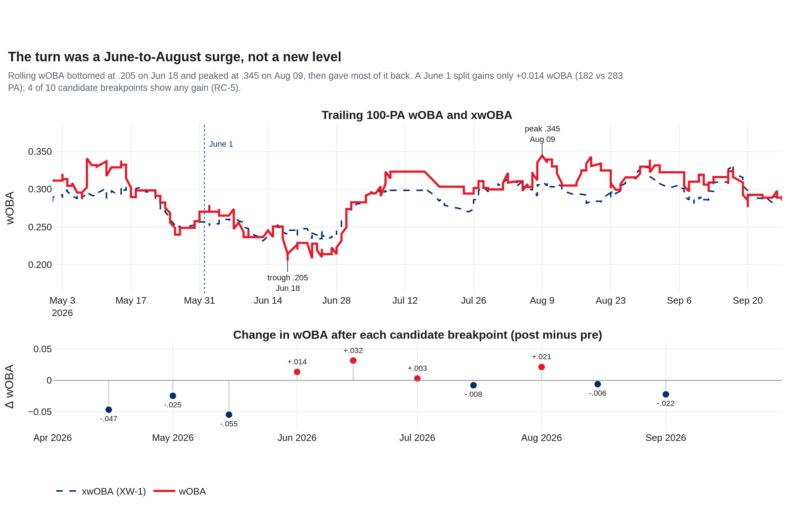
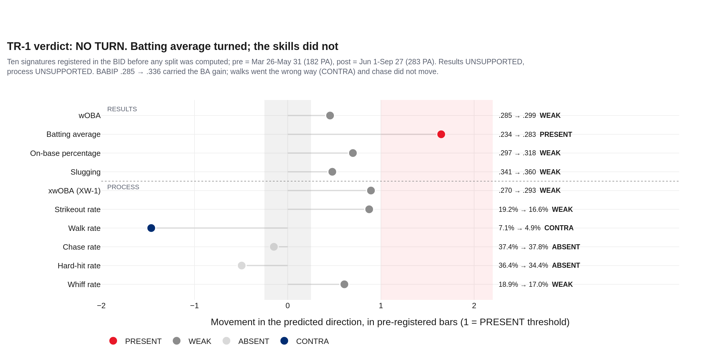
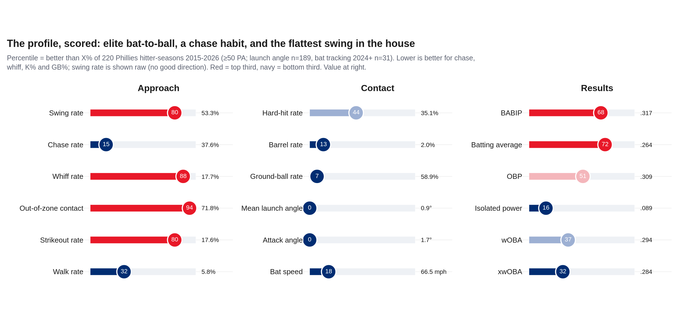
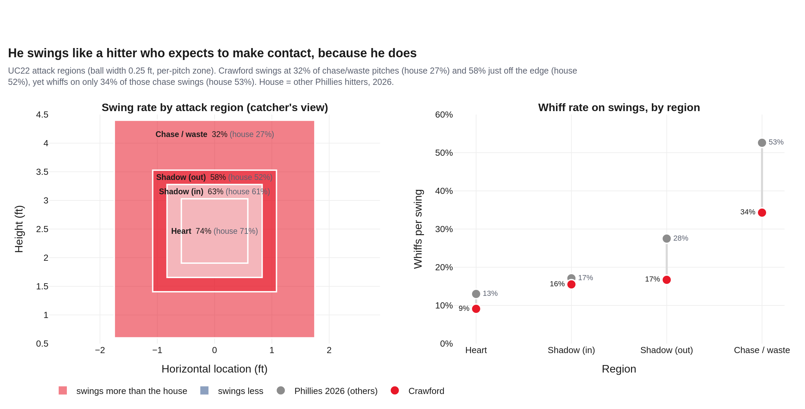
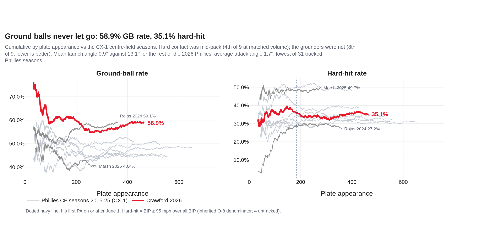
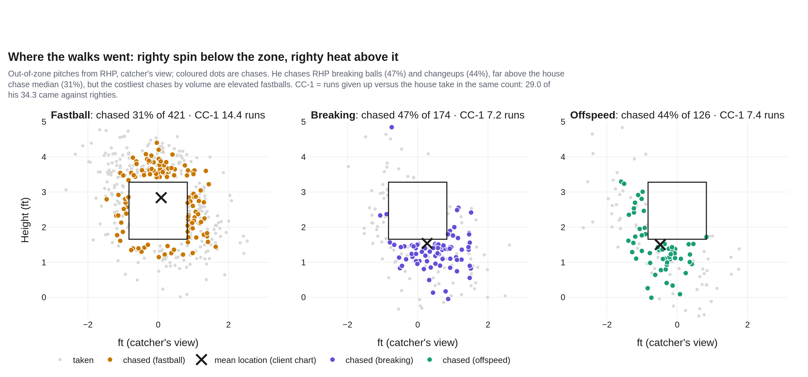
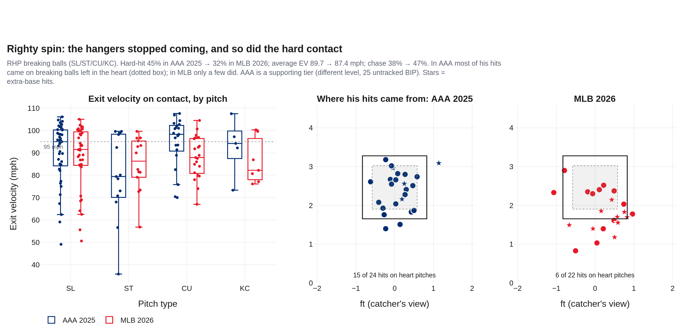
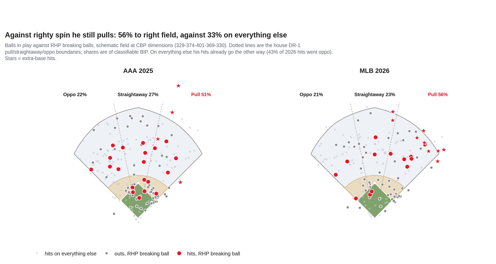
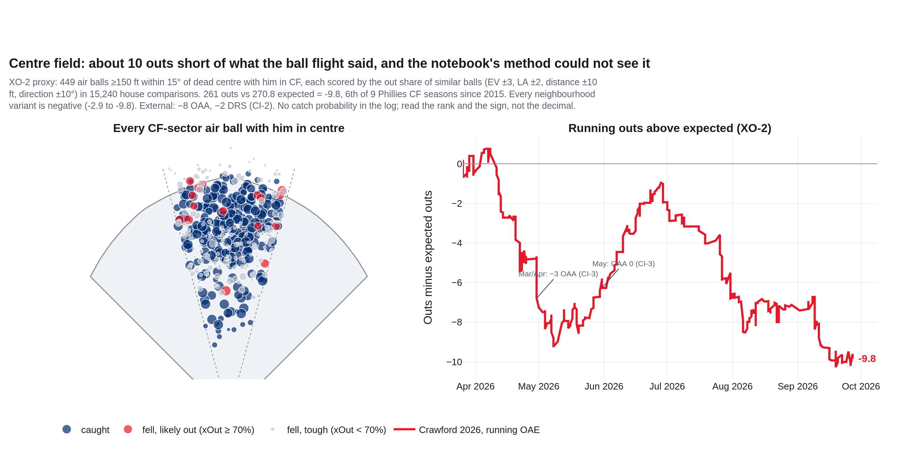

# Exactly as Advertised — Justin Crawford, 2026
### Season recap · CF, bats left · Philadelphia Phillies · 465 PA in 144 games · data through 2026-10-01

**Prepared for:** Player development, hitting and outfield coaches, front office · Justin Crawford

**Approach (2026):** swing 53.3% · chase 37.6% · whiff 17.7% · GB 58.9% · launch angle 0.9°

**Governance:** Use Case #54 (`uc-pos-019`) · build `dp_uc54` v1.0.0 · kernel `dp_uc54_kernel.py` imports `dp_uc40_kernel.py` (sha256 `895c0edc…`), `dp_uc34_kernel.py` (`263e57d1…`) and `dp_uc53_kernel.py` (`03d7e380…`). New objects TR-1, CC-1, XO-2 are provisional; TR-1 was registered in the BID before any split was computed. Independently verified; see `05_quality_certification.md`.

**Companion:** `dp_uc54_crawford_2026_dashboard.html`, the same story in 7 chapters.

> **Read this first: data window, sources, carry-ins.**
>
> - **Entity lock:** MLBAM 702222 with the Phillies batting role, never a name filter (`data/opponents/crawford.parquet` is J.P. Crawford, a trap logged as ENT-2). Regular season for every rate: 465 PA, 1,681 pitches, 144 games with a plate appearance (2026-03-26 to 2026-09-27). Spring (125 pitches) and the Wild Card (25 pitches) are excluded.
> - **AAA 2025** (Lehigh Valley, 507 PA) is a supporting tier. It is labelled wherever it appears and never blended into an MLB rate; its tracking is thinner (25 balls in play without exit velocity).
> - **House ranks are not MLB-wide.** Percentiles compare 220 Phillies hitter-seasons 2015-2026 (50+ PA). Centre-field context is the 9 Phillies primary-CF seasons of the Statcast era (CX-1, inherited from uc-pos-011).
> - **Defense is a proxy.** The log has no catch probability, routes or jumps. XO-2 scores ball flight against similar balls other centre fielders saw; read its sign and its rank, not its decimal.
> - **Carry-ins, never computed on:** debut 2026-03-26 (CI-1, Wikipedia); 149 G, 17 SB in 21, OPS+ 78, −0.2 WAR, −8 OAA, −2 DRS, platoon role once Derek Hill emerged (CI-2, 97.5 The Fanatic, 2026-10-14); −3 OAA in March/April, 0 in May, 97th-percentile sprint speed (CI-3, Philadelphia Inquirer, 2026-06-05); 2025 AAA .334 with 46 SB (CI-4).

## 1 · Bottom line
1. **He was the hitter the scouting report said he would be.** .264/.309/.353, .294 wOBA (xwOBA .284) over 465 PA. Among the 9 Phillies primary-CF seasons since 2015 he ranks 7th in BA and 8th in wOBA at 465 PA, ahead of only Rojas 2024 on wOBA. With runners in scoring position he hit .343 (34 for 99).
2. **"Better from June 1" is half right.** His batting average rose .234 → .283, but wOBA moved only +0.014, his walk rate fell 7.1% → 4.9% and his chase rate did not move. The pre-registered turn test (TR-1) reads **NO TURN**. The real shape was a hole that bottomed in mid-June, a surge to an August 9 peak, and a fade.
3. **The approach is elite contact wrapped around a chase habit.** Swing rate 53.3% (80th percentile), chase 37.6% (better than only 15%), whiff 17.7% (better than 88%), out-of-zone contact 71.8% (better than 94%). The contact keeps strikeouts down; it also turns chases into weak balls in play (.191 BA out of the zone) instead of walks.
4. **The ground-ball rate is the ceiling.** 58.9% grounders, a 0.9° average launch angle (2nd-lowest of 189 Phillies hitter-seasons, lowest of any with 100+ PA) and a 1.7° attack angle (lowest of 31 tracked). His hard-hit rate (35.1%) is mid-pack; the ball is just going into the ground.
5. **For 2027: fewer chases from righties, then lift.** He reached a three-ball count in only 12.0% of plate appearances (10th percentile). Chasing at the house median would have meant about 55 fewer chases, worth roughly 6 runs on the CC-1 arithmetic. In centre field he was about 10 outs short of expectation (-9.8, XO-2), in line with the −8 OAA on record (CI-2). The notebook's method said he made every play; it only counted balls he reached.

## 2 · The rookie line (Q1)

He finished at .264/.309/.353 with 3 home runs, 19 doubles and 5 triples. The cumulative lines tell the season: a hot first two weeks, a slide to a .227 batting average on June 13 (plate appearance 210), then a steady climb back to the middle of the pack for a Phillies centre fielder. On wOBA he sits 8th of 9 at matched volume, between Rojas 2024 and the Herrera seasons. The RISP line (.343/.405/.455, 119 PA) is the brightest number of his year and the least repeatable; it rests on singles and the same ground-ball BABIP as everything else. His final hard-hit rate was 35.1% and his ground-ball rate 58.9%.

| Season | PA | BA | OBP | SLG | OPS | wOBA | xwOBA | BABIP | K% | BB% | HH% | GB% |
|---|---|---|---|---|---|---|---|---|---|---|---|---|
| **MLB 2026** | 465 | .264 | .309 | .353 | .662 | .294 | .284 | .317 | 17.6% | 5.8% | 35.1% | 58.9% |
| RISP 2026 | 119 | .343 | .405 | .455 | | | | | | | | |
| AAA 2025 (supporting) | 507 | .333 | .410 | .451 | .862 | .378 | — | — | 17.6% | 11.4% | 40.7% | 60.7% |

*Phillies primary-CF seasons at 465 PA (or their final PA if fewer), CX-1, CF games only:*

| Rank (wOBA) | Season | BA | OBP | OPS | wOBA |
|---|---|---|---|---|---|
| 1 | Marsh 2023 | .275 | .357 | .801 | .348 |
| 2 | Herrera 2016 | .282 | .364 | .786 | .340 |
| 3 | Herrera 2018 | .273 | .326 | .783 | .338 |
| 4 | Herrera 2015 | .300 | .339 | .771 | .335 |
| 5 | Herrera 2017 | .285 | .325 | .788 | .335 |
| 6 | Marsh 2025 | .277 | .337 | .755 | .328 |
| 7 | Herrera 2021 | .250 | .297 | .693 | .299 |
| 8 | **Crawford 2026** | .264 | .310 | .664 | .294 |
| 9 | Rojas 2024 | .243 | .278 | .601 | .265 |

*Receipts: out/dp_uc54_cum_ba.csv, out/dp_uc54_cum_ops.csv, out/dp_uc54_cum_woba.csv, out/dp_uc54_cf_matched_volume.csv · claim asserted before render*

## 3 · The June turn (Q2)

The notebook's hypothesis was tested with ten signatures registered in the BID before any split was computed. Batting average cleared its bar (PRESENT, +0.049); wOBA, OBP, slugging, xwOBA, strikeout rate and whiff rate moved the right way but short of their bars; chase and hard-hit did not move; walk rate moved the wrong way. Results UNSUPPORTED, process UNSUPPORTED: **NO TURN**. The BA gain came from BABIP (.285 → .336) while isolated power fell (.108 → .078). Only 4 of 10 candidate breakpoints show any wOBA gain at all, and the best one (June 15, +0.032) is the date UC34 was handed in August. What did happen is a surge: trailing-100-PA wOBA rose from .205 (June 18) to .345 (August 9) and finished at .285.

*Receipts: out/dp_uc54_rolling_100pa.csv, out/dp_uc54_breakpoint_scan.csv · claim asserted before render*

*Receipts: out/dp_uc54_tr1_ledger.csv · claim asserted before render*

| Month | PA | BA | OBP | SLG | wOBA | xwOBA | K% | BB% | Chase | GB% | PA vs LHP |
|---|---|---|---|---|---|---|---|---|---|---|---|
| Mar | 13 | .333 | .385 | .333 | .328 | .225 | 23.1% | 7.7% | 30.0% | 55.6% | 38% |
| Apr | 86 | .256 | .326 | .372 | .311 | .289 | 18.6% | 7.0% | 36.7% | 59.7% | 15% |
| May | 83 | .195 | .253 | .312 | .253 | .258 | 19.3% | 7.2% | 38.7% | 63.9% | 13% |
| Jun | 79 | .307 | .333 | .360 | .308 | .291 | 25.3% | 3.8% | 42.7% | 39.3% | 18% |
| Jul | 59 | .259 | .293 | .296 | .264 | .281 | 13.6% | 3.4% | 36.6% | 60.4% | 19% |
| Aug | 84 | .306 | .358 | .403 | .334 | .307 | 8.3% | 8.3% | 32.7% | 67.1% | 2% |
| Sep | 61 | .246 | .267 | .368 | .274 | .286 | 19.7% | 3.3% | 39.1% | 61.7% | 16% |

*March is 13 PA. Every month is below 100 PA; read the run of months, not any one.*

## 4 · The approach (Q3)

High swing, high chase, low whiff: all three confirmed against 220 Phillies hitter-seasons. What makes him unusual is the combination. He swings at 32.5% of pitches well off the plate (house 26.8%) and misses only 34.3% of those swings (house 52.6%). That is why his strikeout rate is low (17.6%, better than 80%). It is also why his walk rate is low (5.8%): the chase pitch becomes a ball in play. Out of the zone he hit .191 with a 16% hard-hit rate; in the zone, .299 and 43%.

*Receipts: out/dp_uc54_profile_percentiles.csv, out/dp_uc54_hitter_pool.csv · claim asserted before render*

*Receipts: out/dp_uc54_attack_regions.csv · claim asserted before render*

| vs | Pitch group | Pitches | PA | wOBA | xwOBA | Chase | Whiff | Hard-hit | Putaway |
|---|---|---|---|---|---|---|---|---|---|
| LHP | breaking | 70 | 21 | .288 | .353 | 46.3% | 23.3% | 13.3% | 16.1% |
| LHP | fastball | 168 | 39 | .260 | .249 | 36.6% | 14.9% | 22.2% | 15.9% |
| LHP | offspeed | 10 | 6 | .341 | .409 | 75.0% | 11.1% | 20.0% | 12.5% |
| RHP | breaking | 312 | 103 | .261 | .247 | 46.6% | 18.3% | 32.1% | 20.0% |
| RHP | fastball | 929 | 225 | .340 | .299 | 30.9% | 17.1% | 43.1% | 16.2% |
| RHP | offspeed | 192 | 71 | .215 | .278 | 44.4% | 20.0% | 29.5% | 9.3% |

*Rows under 50 PA (all three LHP rows) are directional.*

## 5 · Ground balls (Q6)

His ground-ball rate settled at 58.9% and stayed there; only 93% of Phillies hitter-seasons since 2015 hit more grounders. The cause is the swing plane. His 0.9° average launch angle is the 2nd-lowest of 189 Phillies hitter-seasons (only Haseley, Adam 2020 (91 PA) was flatter) and the lowest of any with 100+ PA, against 13.1° for the rest of the 2026 roster, and his average attack angle (1.7°) is the lowest of 31 tracked Phillies seasons. Exit velocity is not the problem: hard-hit rate is 4th of 9 among the CF seasons. Speed props up the grounders: 57 hits on 208 ground balls (.274). After June 1 that rose to .291 on softer contact (81.6 mph vs 85.1) with an expected average of only .259.

*Receipts: out/dp_uc54_cum_gb_rate.csv, out/dp_uc54_cum_hard_hit_rate.csv, out/dp_uc54_cf_matched_volume.csv · claim asserted before render*

## 6 · Where the walks went (Q4)

The walk problem starts upstream. He reached a three-ball count in 12.0% of plate appearances; the house median is 17.4% (10th percentile of 65 Phillies hitter-seasons 2023-26). When he got there he walked 27 times in 56 plate appearances. CC-1 prices every chase against the house take in the same count: 34.3 runs over 319 chases. Per out-of-zone pitch that is near the house median (4.05 vs 3.79 per 100), because he makes contact; the cost is in the volume. 29.0 of the 34.3 runs came against right-handers, and 17.2 came with two strikes. By pitch, his chase rate is highest on righty breaking balls (46.6%) and changeups (44.4%), both buried below the zone, but the costliest by volume are fastballs above it (14.4 runs). Chasing at the house median rate (31.1%) would have taken away about 55 chases, worth roughly 6 runs. Treat that as arithmetic, not a projection.

*Receipts: out/dp_uc54_ooz_pitches.csv, out/dp_uc54_cc1_by_hand_group.csv · claim asserted before render*

| vs | Pitch group | Out-of-zone pitches | Chases | Chase rate | CC-1 runs |
|---|---|---|---|---|---|
| LHP | breaking | 41 | 19 | 46.3% | -0.5 |
| LHP | fastball | 82 | 30 | 36.6% | 5.4 |
| LHP | offspeed | 4 | 3 | 75.0% | 0.5 |
| RHP | breaking | 174 | 81 | 46.6% | 7.2 |
| RHP | fastball | 421 | 130 | 30.9% | 14.4 |
| RHP | offspeed | 126 | 56 | 44.4% | 7.4 |

## 7 · Righty spin (Q4)

The notebook's breaking-ball study holds up. Against RHP breaking balls his batting average barely changed from AAA to MLB (.212 → .224), but the damage did: hard-hit 45.5% → 32.1%, average exit velocity 89.7 → 87.4 mph, and the chase rate rose 38.1% → 46.6%. In AAA, 15 of his 24 hits off righty spin came on pitches in the heart of the zone; in the majors, 6 of 22. Major-league breaking balls end lower (the average hit pitch dropped from 2.39 ft to 1.85 ft). When he does put one in play he pulls it (56% pull vs 33% on everything else). On every other pitch he already uses the whole field: 43% of his 2026 hits went the other way.

*Receipts: out/dp_uc54_rhp_breaking_bip.csv, out/dp_uc54_rhp_breaking_hits.csv, out/dp_uc54_rhp_breaking_by_level.csv · claim asserted before render*

*Receipts: out/dp_uc54_spray_bip.csv, out/dp_uc54_direction_shares.csv · claim asserted before render*

| RHP breaking balls | Pitches | PA | BA | SLG | Hard-hit | Avg EV (tracked n) | Chase | Whiff |
|---|---|---|---|---|---|---|---|---|
| AAA 2025 | 377 | 125 | .212 | .283 | 45.5% | 89.7 (80) | 38.1% | 21.2% |
| MLB 2026 | 312 | 103 | .224 | .367 | 32.1% | 87.4 (78) | 46.6% | 18.3% |

## 8 · Centre field (Q5)

The notebook's similar-hit method, run exactly as written, says he made the plays he should have: 261 outs against 260.5 expected. That method only scores balls he fielded, so a ball that fell in front of him or in the gap never counts against him. XO-2 starts from every air ball of 150+ ft within 15° of dead centre with him in centre (488 balls; 449 scored). Scored against 15,240 similar balls other centre fielders saw, he made 261 outs against 270.8 expected: **-9.8**, 6th of 9 Phillies CF seasons since 2015. The path matches the reporting: a poor April (-6.3; CI-3 has him at −3 OAA in March and April), an even May (+0.5; CI-3: OAA 0), then a July and September slide. The −8 OAA on record (CI-2) lands in the same place.

*Receipts: out/dp_uc54_xo2_opportunities.csv, out/dp_uc54_xo2_sensitivity.csv, out/dp_uc54_xo2_cf_context.csv · claim asserted before render*

| Rank | Phillies CF season | CF games | Scored air balls | Outs above expected | Per 100 |
|---|---|---|---|---|---|
| 1 | Brandon Marsh 2023 | 108 | 367 | +3.1 | +0.85 |
| 2 | Johan Rojas 2024 | 116 | 375 | -4.4 | -1.18 |
| 3 | Odúbel Herrera 2017 | 133 | 496 | -6.3 | -1.26 |
| 4 | Odúbel Herrera 2015 | 136 | 513 | -8.2 | -1.60 |
| 5 | Odúbel Herrera 2021 | 104 | 322 | -5.4 | -1.68 |
| 6 | **Justin Crawford 2026** | 146 | 449 | -9.8 | -2.19 |
| 7 | Brandon Marsh 2025 | 84 | 282 | -7.0 | -2.47 |
| 8 | Odúbel Herrera 2016 | 155 | 593 | -17.9 | -3.03 |
| 9 | Odúbel Herrera 2018 | 133 | 482 | -17.0 | -3.53 |

## 9 · Your notebook, graded

| # | Your claim | Your frame | Governed | Verdict |
|---|---|---|---|---|
| HP-01 | 17.3% K rate | 17.5% | 17.6% | **REPRODUCED** |
| HP-02 | 53.3% swing rate | 53.9% | 53.3% | **REPRODUCED** |
| HP-03 | 37.7% chase rate | 38.3% | 37.6% | **REPRODUCED** |
| HP-04 | 17.6% whiff rate | 18.0% | 17.7% | **REPRODUCED** |
| HP-05 | only 35% hard hits | 35.2% | 35.1% | **REPRODUCED** |
| HP-06 | BA .186 on pitches out of the zone | .185 | .191 | **REPRODUCED** |
| HP-07 | Out-of-zone contact is 'pretty impressive' | 72.4% | 71.8% | **SUPPORTED** |
| HP-08 | Better from ~June 1 on | (chart) | TR-1: NO TURN | **PARTLY** |
| HP-09 | Chased too much against RHP | R 37.3% / L 43.4% | R 37.0% / L 40.9% | **PARTLY** |
| HP-10 | Needs to do damage vs RHP breaking balls | (table) | HH 32.1% vs 43.1% on RHP fastballs | **SUPPORTED** |
| HP-11 | AAA hits on RHP breaking balls were hangers | (pitch map) | heart of zone: AAA 15/24 vs MLB 6/22 | **SUPPORTED** |
| HP-12 | He pulls RHP breaking balls; use the whole field | (spray) | pull 56.4% vs 32.7% on everything else | **SUPPORTED** |
| HP-13 | Defense: made all the plays I would have expected | 261 outs vs 260.5 expected | XO-2 261 vs 270.8 (-9.8) | **NOT SUPPORTED** |
| HP-14 | 'Pretty much the hitter we expected' | (framing) | profile held vs UC34 | **SUPPORTED** |

*Your frame (`jc`) holds 1,834 pitches and 514 PA for 2026: 125 spring and 25 Wild Card pitches, plus 3 duplicated rows from `white-sox-of-25-26.parquet` (SRC-1, SRC-2). Every rate still reproduces within one point. The governed frame is regular season only (465 PA). Evidence for each grade: `out/dp_uc54_hp_grades.csv`.*

## Candid caveats
- 465 PA is one season. The RISP line (119 PA) and every split under 100 PA is directional.
- TR-1's PRESENT bar needs p < .05 where a test applies; at 182 and 283 PA most real changes read WEAK. That is the honest reading of the sample, not a ruling that nothing changed.
- CC-1 prices a chase against the average take in the same count. It does not know what the next pitch would have been, so its totals are indicative.
- XO-2 is a ball-flight proxy. It knows exit velocity, launch angle, distance and direction, not positioning, wind, wall or jump. Every Phillies CF season since 2015 but one scores below zero, so the baseline (all centre fielders in Phillies games) runs high; read the rank. The four neighbourhood variants range -2.9 to -9.8; all negative.
- AAA comparisons cross levels and tracking systems (25 untracked AAA balls in play).
- Postseason (Wild Card, 3 games): 1 hit in 7 at-bats, 7 PA. Shown here only; never in a rate.
- The August platoon shielding found by uc-pos-011 continued (CI-2). His splits vs LHP (66 PA) are too thin to judge it.
