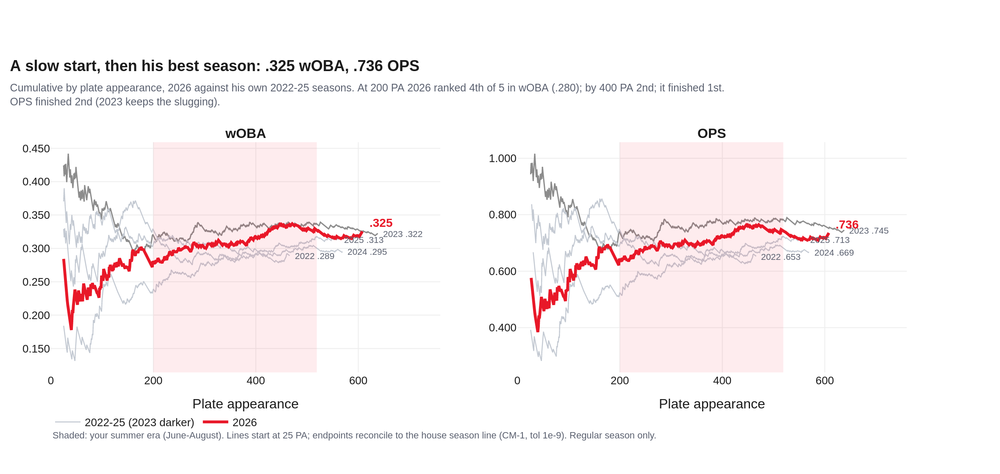
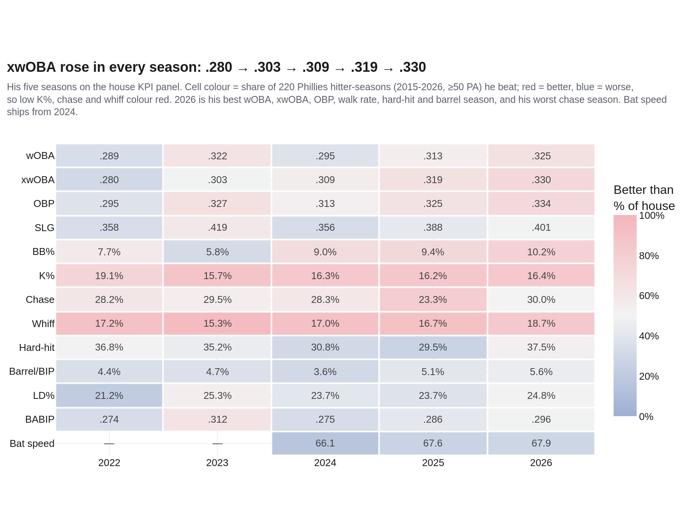
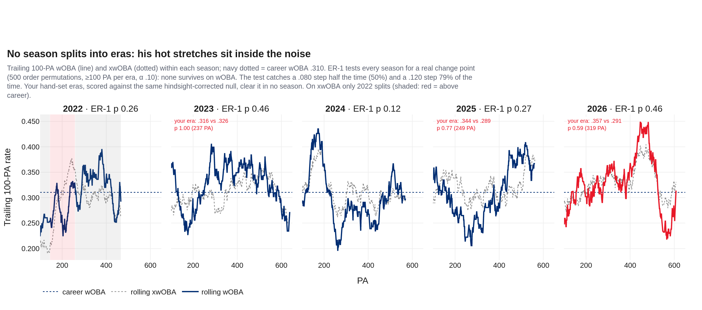
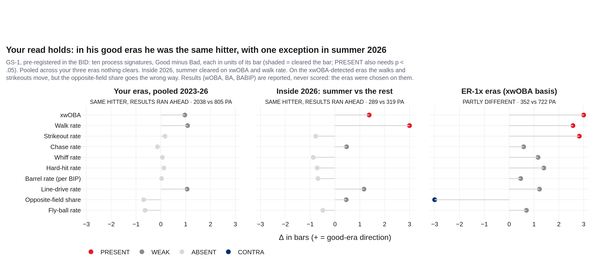
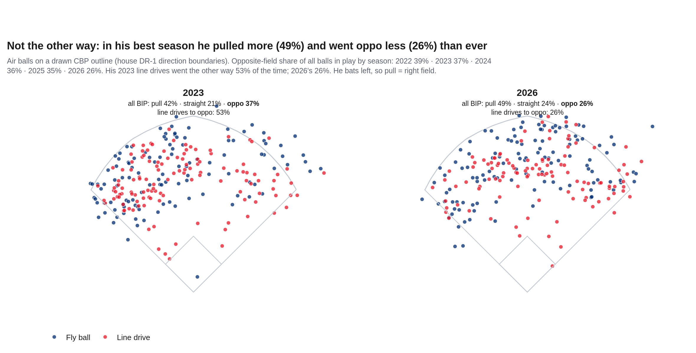
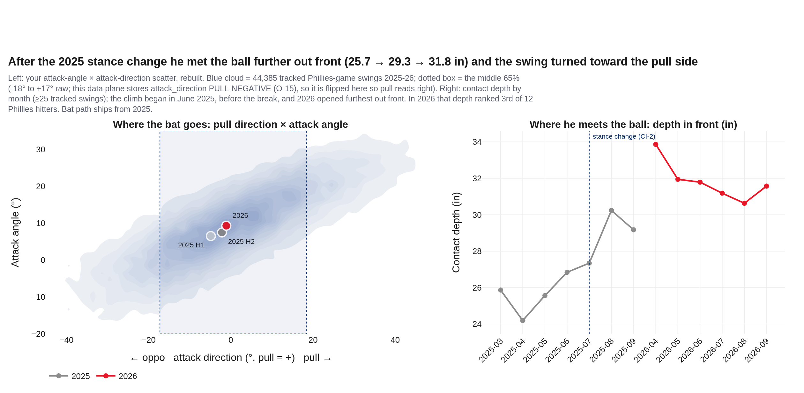
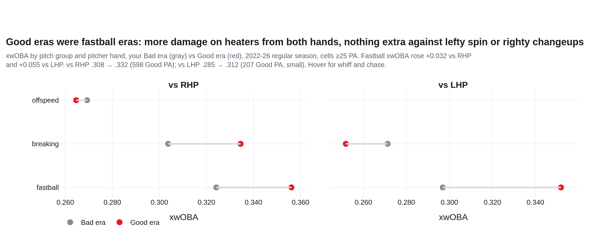
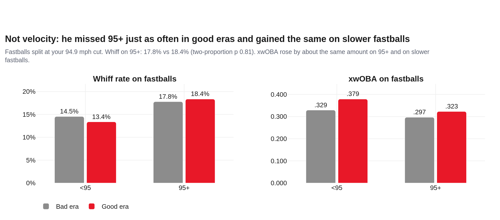
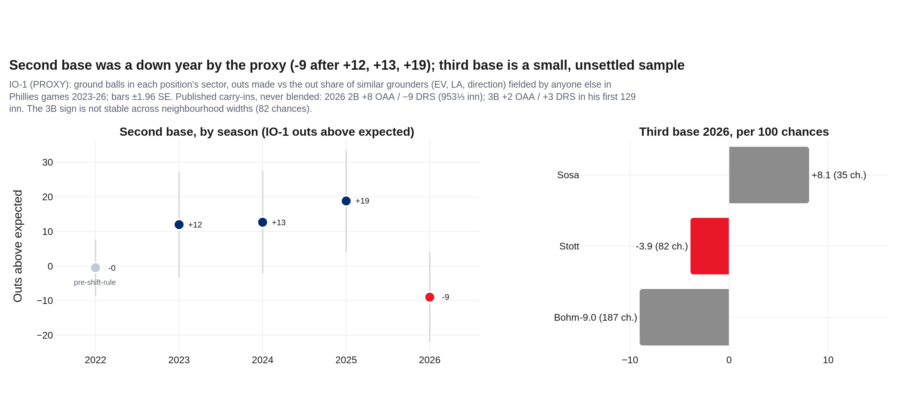
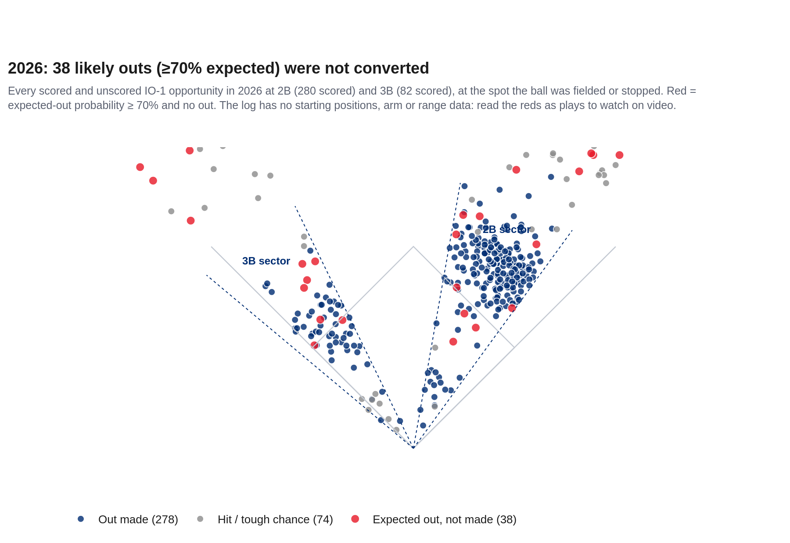

# Another Level? — Bryson Stott, 2026
### Season recap · 2B/3B, bats left · Philadelphia Phillies · 608 PA in 155 games · data through 2026-10-01

**Prepared for:** Front office, player development, hitting and infield coaches

**2026:** .256/.334/.401 · wOBA .325 · xwOBA .330 · BB 10.2% · K 16.4% · chase 30.0%

**Governance:** Use Case #55 (`uc-pos-020`) · build `dp_uc55` v1.0.0 · kernel `dp_uc55_kernel.py` imports `dp_uc54_kernel.py` (sha256 `1a31b30a…`) and `dp_uc40a_kernel.py` (`807986c0…`), with 14 pins in all. New objects ER-1, GS-1 and IO-1 are provisional; ER-1 and GS-1 were registered in the BID before any era split was computed. Independently verified; see `05_quality_certification.md`.

**Companion:** `dp_uc55_stott_2026_dashboard.html`, the same story in 7 chapters.

> **Read this first: data window, sources, carry-ins.**
>
> - **Entity lock:** MLBAM 681082 with the Phillies batting role (fielder_4 / fielder_5 on defense), never a name filter. Regular season for every rate, 2022-26; 608 PA in 2026 across 155 games (2026-03-26 to 2026-09-27).
> - **Your notebook's frame** (`pos[pos.player_name == pn]`) has no game-type filter: it carries 182 non-regular PA across 2022-26, including 37 spring-training and 3 exhibition PA in 2026 (SRC-4). Section 8 grades your claims on your frame first, then on the governed one.
> - **Postseason** is a ledger line, never a rate: 2026 Wild Card 13 PA, 2 hits.
> - **Carry-ins (quoted, never computed on):** CI-1 2026 line .256, 10 HR, 62 BB (thatballsouttahere, 10/22) · CI-2 2B 2026 +8 OAA / −9 DRS in 953⅓ inn; 2025 second half .294 / .855 OPS after a stance change under Kevin Long; Dombrowski: "I don't know why he can't be that player all the time" (On Pattison, 10/18) · CI-3 moved to 3B after the Arraez trade: +2 OAA / +3 DRS in 129 inn; "not … a third baseman for the long term" (Inquirer / Central Bucks News, 8/19-20) · CI-4 career 2B +33 OAA / +8 DRS · CI-5 Bohm in his final contract year (NBC Sports Philadelphia, 5/6).
> - **Bat path** ships from 2025 and bat speed from 2024 (NULL before, never imputed). In this data plane `attack_direction` is **pull-negative** and stand-normalised (O-15, re-proven at build); the report flips it so pull reads positive.
> - **Defense is a proxy.** IO-1 scores ground balls against similar grounders; the log has no starting position, range, arm or catch data. OAA and DRS appear beside it as carry-ins, never blended.

## 1 · Bottom line: another level?
1. **2026 was his best season, and it wasn't a fluke.** .256/.334/.401, a .325 wOBA and .330 xwOBA, both career highs, with career-best walk (10.2%), hard-hit (37.5%) and barrel (5.6%) rates. His xwOBA has risen in every season of his career: .280 → .303 → .309 → .319 → .330.
2. **The "good eras" are mostly noise.** ER-1 looked for a real change point in every season and found none on wOBA. Your three hand-set eras don't clear a hindsight-corrected test either (p 1.00 / 0.77 / 0.59). The early-2023 era wasn't even better by wOBA (.319 vs .330); it was a BABIP run.
3. **You were right that he's the same hitter in good and bad stretches** (GS-1: same hitter, results ran ahead). The exception is summer 2026: walks (7.6% → 12.5%) and xwOBA (.312 → .346) really moved. So did luck: BABIP went .245 → .346.
4. **The real level-up already happened, and it was mechanical, not seasonal.** After the 2025 stance change he met the ball 25.7 → 29.3 → 31.8 inches further out front, and his swing turned toward the pull side. He pulled 49.1% of his balls in play in 2026 (a career high) and went the other way 26.5% (a career low). So, no, he isn't using all fields; the pull is what's working.
5. **The level left is the zone, not more power.** 2026 was his worst chase season (30.0%; 23.3% in 2025) and his worst whiff season (18.7%). His best month, August (.370 wOBA, 17.2% walks), came with his lowest chase (24.0%). Bat speed ranks 10th of 12 Phillies hitters, so extra slug is not the easy lever.
6. **Defense:** by the IO-1 proxy, second base was a down year (-9 outs after +12 / +13 / +19), in line with the −9 DRS carry-in and against the +8 OAA. Third base (82 chances) is too small and unstable to settle a move. Moving him there puts Arraez's bat in Bohm's place (ISO .090 vs .133): your "limited thump" worry holds.

## 2 · The 2026 line (Q1, Q7)

He started cold: 2026 ranked 4th of his five seasons in cumulative wOBA at 200 PA (.280) and still 2nd at 400 PA, then finished 1st (.325). OPS finished 2nd (.736) because 2023 kept more slugging (.419 vs .401). On the house panel 2026 is his best xwOBA, best walk rate and best barrel rate, and his 5th-best chase rate of five (the worst). Against 220 Phillies hitter-seasons since 2015, the 2026 xwOBA beats 73%.

| Season | PA | AVG/OBP/SLG | wOBA | xwOBA | BB% | K% | Chase | Whiff | Hard-hit | Barrel | LD% |
|---|---|---|---|---|---|---|---|---|---|---|---|
| 2022 | 466 | .234/.295/.358 | .289 | .280 | 7.7% | 19.1% | 28.2% | 17.2% | 36.8% | 4.4% | 21.2% |
| 2023 | 638 | .280/.327/.419 | .322 | .303 | 5.8% | 15.7% | 29.5% | 15.3% | 35.2% | 4.7% | 25.3% |
| 2024 | 569 | .245/.313/.356 | .295 | .309 | 9.0% | 16.3% | 28.3% | 17.0% | 30.8% | 3.6% | 23.7% |
| 2025 | 562 | .255/.325/.388 | .313 | .319 | 9.4% | 16.2% | 23.3% | 16.7% | 29.5% | 5.1% | 23.7% |
| **2026** | 608 | .256/.334/.401 | .325 | .330 | 10.2% | 16.4% | 30.0% | 18.7% | 37.5% | 5.6% | 24.8% |

*Receipts: out/dp_uc55_cum_woba.csv, out/dp_uc55_cum_ops.csv, out/dp_uc55_cum_checkpoints.csv · claim asserted before render*

*Receipts: out/dp_uc55_season_card.csv · claim asserted before render*

| 2026 | PA | AVG | OBP | SLG | wOBA | xwOBA | BB% | K% | Chase |
|---|---|---|---|---|---|---|---|---|---|
| Mar | 13 | .250 | .308 | .250 | .259 | .322 | 7.7% | 15.4% | 48.3% |
| Apr | 82 | .200 | .250 | .280 | .238 | .285 | 4.9% | 19.5% | 32.7% |
| May | 104 | .227 | .269 | .474 | .317 | .314 | 5.8% | 14.4% | 30.6% |
| Jun | 107 | .287 | .374 | .415 | .351 | .356 | 11.2% | 18.7% | 32.5% |
| Jul | 96 | .287 | .344 | .460 | .347 | .314 | 8.3% | 22.9% | 33.8% |
| Aug | 116 | .284 | .409 | .411 | .370 | .363 | 17.2% | 12.1% | 24.0% |
| Sep | 90 | .237 | .337 | .355 | .312 | .331 | 12.2% | 12.2% | 26.9% |

*March is 13 PA; every month is under 120 PA. Read the run of months, not any one.*

## 3 · What "Good" looks like: the timeframe question (Q2)

You asked for a better way to set the timeframes. ER-1 is that tool. It splits a season only where the PA-by-PA wOBA changes more than shuffling the same plate appearances would produce: at least 100 PA per era, 500 shuffles, α .10. **No season splits on wOBA.** First-split p values run 0.12 to 0.46. The tool has limited power: it catches a .080-wOBA step half the time and a .120 step 79% of the time. So the honest answer is that his hot and cold stretches are ordinary variance around a level that rises season by season. On xwOBA only his rookie 2022 splits (a .375 middle stretch between weaker starts and finishes). Your eras, scored against the same hindsight-corrected null, don't clear it. They also aren't one thing: early 2023 was a BABIP run (BABIP .330, ISO .113 vs .154 the rest of the year). 2025's second half was a power change (ISO .096 → .182, BABIP flat). Summer 2026 was walks plus BABIP. The cell in `out/dp_uc55_er1_notebook_cell.md` drops ER-1 into your notebook in place of `hot_or_not`.

*Receipts: out/dp_uc55_rolling_100pa.csv, out/dp_uc55_er1_segments_woba.csv, out/dp_uc55_er1_segments_xwoba.csv, out/dp_uc55_er1_tests_woba.csv, out/dp_uc55_er1_power_woba.csv, out/dp_uc55_client_split_woba.csv · claim asserted before render*

| Your era | Good PA | wOBA Good / rest | xwOBA Good / rest | BA Good / rest | BABIP Good / rest | ISO Good / rest | p (hindsight-corrected) |
|---|---|---|---|---|---|---|---|
| Mar-May 2023 | 237 | .316 / .326 | .296 / .307 | .290 / .275 | .330 / .301 | .113 / .154 | 1.00 |
| Jul-Sep 2025 | 249 | .344 / .289 | .331 / .309 | .273 / .241 | .289 / .284 | .182 / .096 | 0.77 |
| Jun-Aug 2026 | 319 | .357 / .291 | .346 / .312 | .286 / .223 | .346 / .245 | .141 / .150 | 0.59 |

*p = share of 500 order-shuffled seasons whose best possible split beats your split. It corrects for having picked the window after seeing the season.*

## 4 · The A/B test, done properly (Q3)

GS-1 was pre-registered in the BID: ten process signatures with a bar each, scored Good minus Bad. Pooled over your three eras (805 vs 2038 PA), 0 of 10 clear. The call is **SAME HITTER, RESULTS RAN AHEAD**, which is your read. Inside 2026, summer cleared on xwOBA and walk rate (both PRESENT). On the xwOBA-detected eras (ER-1x) the call is PARTLY DIFFERENT: walks, strikeouts and xwOBA move, and the opposite-field share goes the wrong way. Whole-season 2026 against 2022-25 reads the same way (PARTLY DIFFERENT). The gain is contact quality with more pull, not more oppo.

*Receipts: out/dp_uc55_gs1_ledger.csv, out/dp_uc55_era_metrics.csv · claim asserted before render*

| Sig | Signature (bar) | Your eras: Bad → Good | verdict | Summer 2026: rest → summer | verdict |
|---|---|---|---|---|---|
| S1 | xwOBA (0.025) | .302 → .327 | WEAK | .312 → .346 | PRESENT |
| S2 | Walk rate (0.015) | 7.9% → 9.6% | WEAK | 7.6% → 12.5% | PRESENT |
| S3 | Strikeout rate (0.030) | 16.8% → 16.3% | ABSENT | 15.2% → 17.6% | ABSENT |
| S4 | Chase rate (0.030) | 27.8% → 28.3% | ABSENT | 30.8% → 29.4% | WEAK |
| S5 | Whiff rate (0.030) | 17.0% → 16.8% | ABSENT | 17.3% → 19.9% | ABSENT |
| S6 | Hard-hit rate (0.040) | 33.8% → 34.3% | ABSENT | 38.9% → 36.0% | ABSENT |
| S7 | Barrel rate (per BIP) (0.020) | 4.7% → 4.7% | ABSENT | 6.3% → 5.0% | ABSENT |
| S8 | Line-drive rate (0.030) | 23.0% → 26.2% | WEAK | 23.1% → 26.6% | WEAK |
| S9 | Opposite-field share (0.030) | 35.2% → 33.2% | ABSENT | 25.8% → 27.1% | WEAK |
| S10 | Fly-ball rate (0.030) | 26.2% → 24.3% | ABSENT | 27.6% → 26.1% | ABSENT |

## 5 · All fields? Line drives or fly balls? The bat path (Q4, Q5)

**Not all fields.** His opposite-field share fell every season (39% · 37% · 36% · 35% · 26%) and his pull share hit a career high in 2026 (49%). His 2023 line drives went the other way 53% of the time, 2026's 26%. **Line drives, not fly balls:** his line-drive rate was 24.8% (2nd-best of his seasons); fly balls didn't move in his good eras. The bat path shows why. Through the 2025 halves and into 2026 his contact point moved 25.7 → 29.3 → 31.8 in in front of his body (3rd of 12 Phillies in 2026). His swing direction turned from -4.9° to -1.1° (pull +), and his attack angle rose 6.9° → 9.3° (ideal-range swings 49% → 54%). Your attack-direction probe, governed: the middle 65% of swings runs -18° to +17° (raw sign). Inside it his balls in play were hard-hit 35% of the time, outside it 23%.

*Receipts: out/dp_uc55_spray_bip.csv, out/dp_uc55_direction_shares.csv · claim asserted before render*

*Receipts: out/dp_uc55_bat_path_population_density.csv, out/dp_uc55_bat_path_2025_halves.csv, out/dp_uc55_bat_path_by_year.csv, out/dp_uc55_bat_path_by_month.csv, out/dp_uc55_bat_path_peers.csv · claim asserted before render*

| Window | Tracked swings | Contact depth (in) | Swing direction (pull +) | Attack angle | Ideal-angle swings | Bat speed | Swing length |
|---|---|---|---|---|---|---|---|
| 2025 H1 | 597 | 25.7 | -4.9° | 6.5° | 47% | 67.7 | 7.16 |
| 2025 H2 | 377 | 29.3 | -2.2° | 7.5° | 53% | 68.5 | 7.06 |
| 2026 rest | 465 | 32.5 | -0.0° | 10.2° | 58% | 68.5 | 7.18 |
| 2026 summer | 554 | 31.2 | -2.0° | 8.6° | 50% | 68.0 | 7.15 |

*Swing-path tilt is not compared year over year: it fell -1.2° for the median Phillies hitter 2025 → 2026 (O-16); his moved -1.7°.*

## 6 · Lefties, righties, pitch types, velocity (Q6)

**Both hands, fastballs.** In good eras his xwOBA rose against righties (.308 → .332) and lefties (.285 → .312, 207 PA). The gain sits in fastballs from both hands; offspeed from righties and breaking balls from lefties didn't improve. In 2026 he hit lefties as well as righties (.327 vs .325 wOBA, 145 PA vs LHP), a reversal of 2025 (.259). **Not velocity:** he whiffed on 95+ just as often in good eras (17.8% vs 18.4%, p 0.81).

*Receipts: out/dp_uc55_hand_group_era.csv, out/dp_uc55_platoon_by_era.csv · claim asserted before render*

*Receipts: out/dp_uc55_velocity_by_era.csv, out/dp_uc55_velocity_by_year.csv · claim asserted before render*

| Season | vs | PA | wOBA | xwOBA | K% | Chase |
|---|---|---|---|---|---|---|
| 2024 | LHP | 129 | .274 | .298 | 20.2% | 23.0% |
| 2024 | RHP | 440 | .301 | .312 | 15.2% | 29.8% |
| 2025 | LHP | 123 | .259 | .281 | 17.9% | 21.1% |
| 2025 | RHP | 439 | .329 | .329 | 15.7% | 23.9% |
| 2026 | LHP | 145 | .327 | .309 | 16.6% | 27.6% |
| 2026 | RHP | 463 | .325 | .336 | 16.4% | 30.8% |

*Every LHP row is under 150 PA: directional.*

## 7 · Second base, third base, and the thump question (Q8)

IO-1 scores every ground ball in a position's sector against grounders with similar exit velocity, launch angle and direction fielded by anyone else in Phillies games since the 2023 shift rules. At second base he was +12, +13 and +19 outs above expected in 2023-25, then **-9 in 2026** (280 chances). The sign holds across all four neighbourhood widths. That agrees with the −9 DRS carry-in and disagrees with the +8 OAA. At third base he was -3.2 on 82 chances: better than Bohm's 2026 there (-9.0 per 100 vs his -3.9), with a sign that flips with the neighbourhood width. That isn't enough to call a full-time move, and Dombrowski has said it isn't the plan (CI-3). **The thump:** Stott to third means Arraez at second instead of Bohm's bat at third. In 2026 Arraez hit 2 HR in 192 Phillies PA (ISO .090, barrels 2.3%). Bohm hit 15 HR (ISO .133). The median 2026 Phillies hitter (≥50 PA, n 16) had an ISO of .134.

*Receipts: out/dp_uc55_io1_summary.csv, out/dp_uc55_io1_phillies_context.csv, out/dp_uc55_io1_sensitivity.csv · claim asserted before render*

*Receipts: out/dp_uc55_io1_opportunities.csv · claim asserted before render*

| Position | Season | Chances scored | Outs | Expected | IO-1 outs above expected | Per 100 | Coverage |
|---|---|---|---|---|---|---|---|
| 2B | 2022 (pre-rule) | 113 | 86 | 86.5 | -0.5 | -0.4 | 94% |
| 2B | 2023 | 389 | 306 | 294.0 | +12.0 | +3.1 | 95% |
| 2B | 2024 | 342 | 265 | 252.3 | +12.7 | +3.7 | 96% |
| 2B | 2025 | 333 | 262 | 243.2 | +18.8 | +5.7 | 95% |
| 2B | 2026 | 280 | 203 | 212.0 | -9.0 | -3.2 | 93% |
| 3B | 2022 (pre-rule) | 8 | 5 | 5.3 | -0.3 | -4.3 | 100% |
| 3B | 2026 | 82 | 54 | 57.2 | -3.2 | -3.9 | 92% |

*Carry-ins beside, never blended: 2026 2B +8 OAA / −9 DRS (953⅓ inn); 3B +2 OAA / +3 DRS (first 129 inn); career 2B +33 OAA / +8 DRS.*

| 2026, Phillies PA | PA | HR | ISO | SLG | Barrel/BIP | xwOBA | wOBA |
|---|---|---|---|---|---|---|---|
| Sosa, Edmundo | 250 | 9 | .182 | .429 | 7.2% | .330 | .307 |
| Stott, Bryson | 608 | 10 | .146 | .401 | 5.6% | .330 | .325 |
| Bohm, Alec | 632 | 15 | .133 | .381 | 6.0% | .327 | .307 |
| Arraez, Luis | 192 | 2 | .090 | .367 | 2.3% | .315 | .295 |

*Arraez's Phillies PA start 2026-08-04; Stott's first game at third was 2026-08-04.*

## 8 · Your notebook, graded

Each claim is reproduced on your own frame with your own functions, then restated on the governed frame. The receipts are `out/dp_uc55_hp_*.csv`.

| # | Your claim | Your frame | Governed | Grade |
|---|---|---|---|---|
| HP-01 | 2026 'very good ... nearly in line with 2023 or better in some ways' | wOBA 2026 .322 vs 2023 .317 | wOBA .325 vs .322; xwOBA .330 vs .303 | **SUPPORTED** |
| HP-02 | 'He is barreling the ball better nowadays' | 5.6% | 5.6% per BIP, best of his 5 seasons (rank 1) | **SUPPORTED** |
| HP-03 | 'Walked more than ever this year' | 9.7% | 10.2% (62 BB), best of his 5 seasons | **REPRODUCED** |
| HP-04 | 'Pretty consistent K rate' | 19.3% / 16.5% / 16.7% / 16.5% / 16.9% | 19.1% / 15.7% / 16.3% / 16.2% / 16.4% | **SUPPORTED** |
| HP-05 | 'Line drives up to 2023 levels' | 24.9% vs 25.6% | 24.8% vs 25.3% | **SUPPORTED** |
| HP-06 | 'Chased more than ever' | 30.4% | 30.0%, worst of his 5 seasons | **SUPPORTED** |
| HP-07 | Good vs Bad: 'pretty much the same hitter' | (A/B by eye) | GS-1 on your eras: SAME HITTER, RESULTS RAN AHEAD | **SUPPORTED** |
| HP-08 | Platoon: no noticeable Good/Bad difference by hand | wOBA vs L .293 -> .325; vs R .296 -> .339 | xwOBA vs L .285 -> .312; vs R .308 -> .332 | **SUPPORTED** |
| HP-09 | 'It might be velocity?' | (table) | 95+ fastballs: whiff 17.8% vs 18.4% (p 0.81) | **NOT SUPPORTED** |
| HP-10 | Attack-direction 'middle 65%' = -18 to +13 | -18.6 to +17.3 (client frame quantiles) | -18.4 to +17.3 (BP-0 tracked swings, 44,385) | **PARTLY** |
| HP-11 | 2B 2026 'might have been a down year' | (no code) | IO-1 -9.0 outs vs +18.8 (2025) | **SUPPORTED** |
| HP-12 | 3B 'good enough ... to potentially move there full time' | (no code) | IO-1 3B -3.2 on 82 opps; Bohm -16.9 | **OPEN** |
| HP-13 | 'This team has limited thump if so' | (no code) | ISO Arraez .090 vs Bohm .133 | **SUPPORTED** |
| HP-14 | Thesis: 'I don't believe' there is another level | - | xwOBA rose every season (.280 -> .303 -> .309 -> .319 -> .330) | **PARTLY** |

**Three things for 2027**

1. **Keep the contact point.** 31.8 in out front is the change behind the career-best contact. It held all season; protect it in the off-season work.
2. **Take back the zone.** Chase 30.0% → his 2025 level (23.3%) is the cheapest +OBP on the table. August (24.0% chase, 17.2% walks) is the proof of concept inside this season.
3. **Stop chasing the eras.** Judge 2027 by season-level xwOBA and the ER-1 test, not by hot months; his good stretches have been variance around a rising line.

**Candid caveats**

- ER-1 has limited power at one season of PA. "No split" means no change large enough to separate from variance, not proof that nothing changed.
- GS-1 eras were chosen on results, so results are reported and never scored. Process signatures are the test.
- Bat-path metrics exist for 2025-26 only. The 2025 stance change is a dated carry-in. The depth climb began in June 2025, before the break, and no causal claim is made.
- IO-1 is a proxy: no starting positions, range, arm or hang time. The pool was widened (A-1) and the neighbourhood loosened (A-2) after coverage gates failed; both are disclosed in 03 §2. Third base is 2026-only and small.
- The house hitter pool is Phillies hitter-seasons (2015-26, ≥50 PA), not MLB.
- Inherited exposures: 4 untracked balls in play count as not hard-hit (O-8); truncated PA count as PA (TP-1, 05 §1).

*Built by the agentified data-product organization · UC #55 · governance trail: `Agents for Data Products/data-products/uc-pos-020-stott-2026-recap-001/` (BID, 00–07).*
