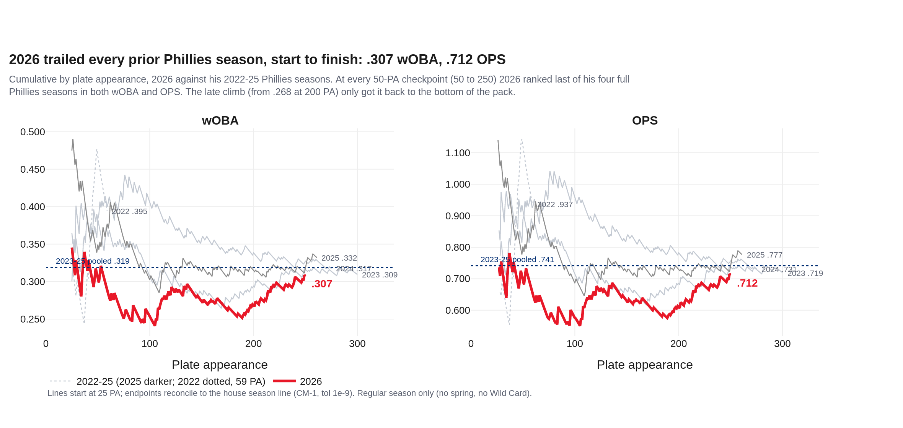
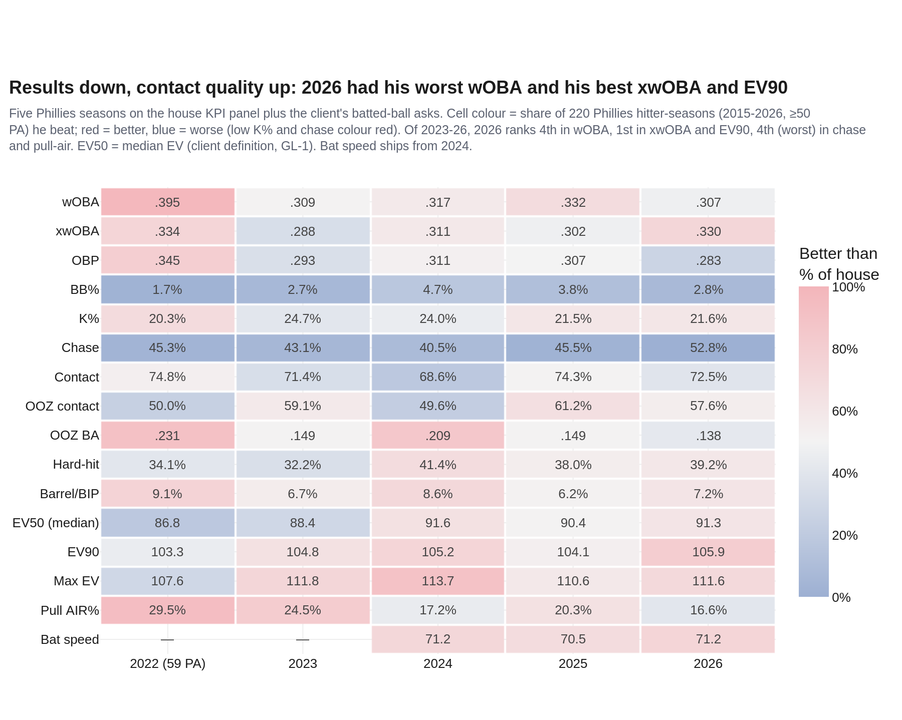
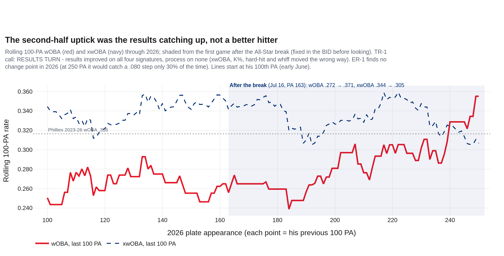
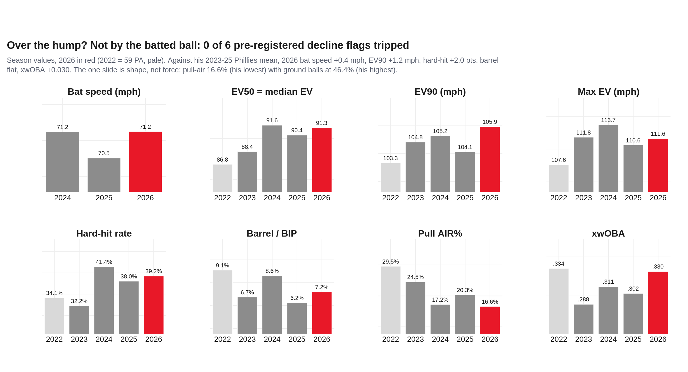
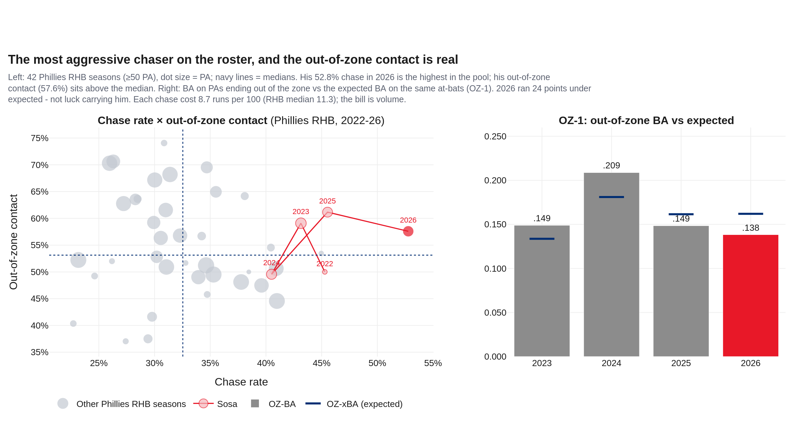
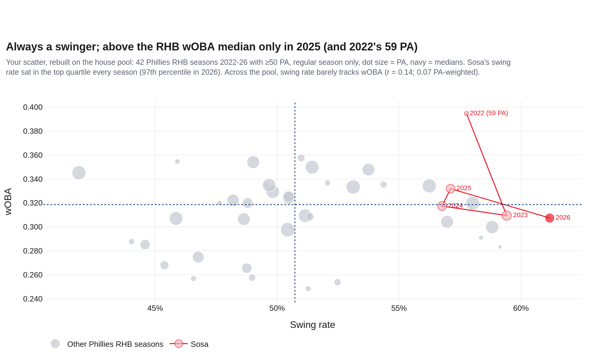
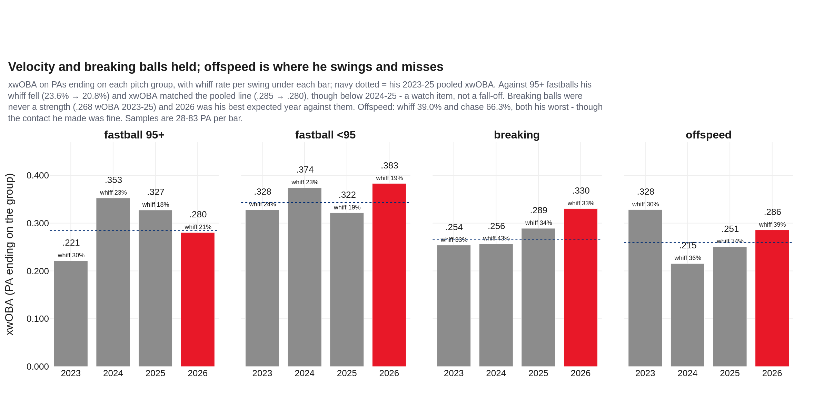
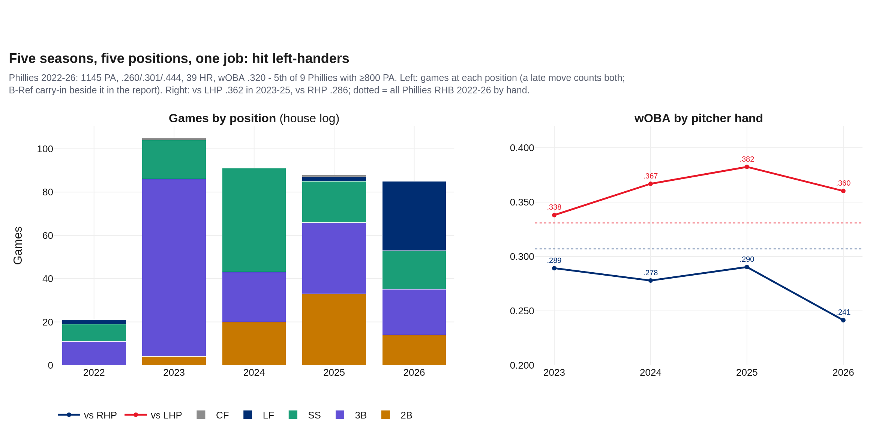
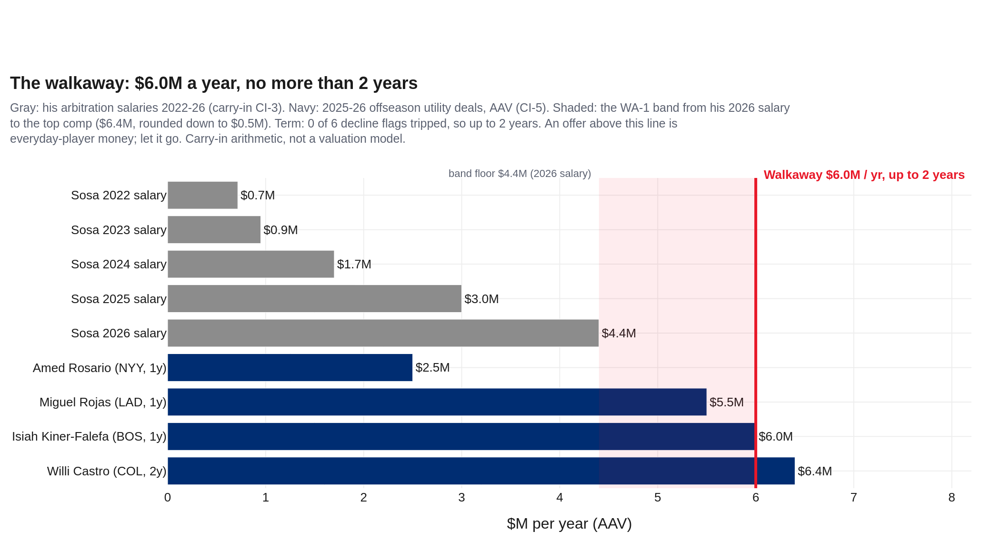

# We Really Do Love Sosa — Edmundo Sosa's 2026, and maybe his Phillies run
### Season recap · utility IF/OF, bats right · Philadelphia Phillies · 250 PA in 83 games · data through 2026-10-01

**Prepared for:** Front office (free-agency decision), player development, hitting coaches

**2026:** .247/.283/.429 · wOBA .307 · xwOBA .330 · BB 2.8% · K 21.6% · chase 52.8% · OOZ contact 57.6%

**Governance:** Use Case #56 (`uc-pos-021`) · build `dp_uc56` v1.0.0 · kernel `dp_uc56_kernel.py` imports `dp_uc55_kernel.py` (sha256 `9bdcce59…`) and `dp_uc46_kernel.py` (`a45ac9a7…`), 16 pins in all. New objects OZ-1 and WA-1 are provisional and were registered in the BID before computation. Independently verified; see `05_quality_certification.md`.

**Companion:** `dp_uc56_sosa_2026_dashboard.html`, the same story in 8 chapters.

> **Read this first: data window, sources, carry-ins.**
>
> - Regular season only for every rate. The client's frame also carried 19 spring and 7 Wild Card PA in 2026 (SRC-4) and his St. Louis years from a second file (SRC-5); both are graded in §8, never pooled.
> - Baseline for 'prior Phillies years' = 2023-25 (836 PA). 2022 in Philadelphia was 59 PA: shown, never a baseline (SRC-6).
> - House log through 2026-10-01; 2026 = 250 PA in 83 games, 138 vs LHP / 112 vs RHP. Reconciles to Baseball-Reference (CI-1: .247/.283/.429, 250 PA).
> - Carry-ins (labelled CI-n) come from Baseball-Reference, NBC Sports Philadelphia, PhillyVoice, Spotrac, MLB.com, ESPN and the AP; they are quoted, never computed on. The walkaway band (§7) is arithmetic on carry-ins and says so.
> - EV50 here is the median exit velocity (the client's definition, GL-1). Statcast's public EV50 is the mean of the hardest 50% of batted balls; the two are not interchangeable.

## 1 · Bottom line
1. **Yes, 2026 was a down year - in results.** .307 wOBA and .712 OPS were the worst of his four full Phillies seasons, and the cumulative line ran last at every 50-PA checkpoint.
2. **No, it wasn't a down year in the bat.** His .330 xwOBA was the best of his four full Phillies seasons, his EV90 (105.9 mph) a career high, and bat speed held (71.2 mph). Zero of six pre-registered decline flags tripped. BABIP .281 was his lowest.
3. **The late uptick was the results catching up, not a better hitter.** After the break, wOBA rose .272 → .371 while xwOBA fell .344 → .305 (TR-1: RESULTS TURN).
4. **The chase-and-contact approach is sustainable, and expensive in volume.** 52.8% chase was the highest of 42 Phillies RHB seasons since 2022, but his out-of-zone contact is above the median and his out-of-zone BA was earned (OZ-1). Each chase costs less than a typical righty's; he just chases more.
5. **He's a bench bat who mashes lefties, not an everyday player.** vs LHP .362 wOBA (2023-25), vs RHP .286, with a 2.8% walk rate. Five seasons, five positions, a .320 Phillies wOBA - 5th of 9 Phillies with 800+ PA.
6. **Walkaway: $6.0M a year, no more than 2 years.** Open near his 2026 salary ($4.4M, CI-3). If another club pays more or longer, it's paying for an everyday player - let him go.

## 2 · The 2026 line (Q1)

.247/.283/.429, .307 wOBA, .712 OPS. Against his own 2023-25 Phillies seasons, 2026 ranks 4th of four in wOBA, OBP and OPS - and 1st in xwOBA. The cumulative lines put it plainly: 2026 was last at 50, 100, 150, 200 and 250 PA, bottoming at .253 at 100 PA. The season card says why it isn't the whole story: his contact quality was the best it's been.

| Season | PA | AVG/OBP/SLG | wOBA | xwOBA | BB% | K% | Swing | Chase | OOZ contact | Hard-hit | Barrel | EV90 |
|---|---|---|---|---|---|---|---|---|---|---|---|---|
| 2022 | 59 | .315/.345/.593 | .395 | .334 | 1.7% | 20.3% | 57.8% | 45.3% | 50.0% | 34.1% | 9.1% | 103.3 |
| 2023 | 300 | .251/.293/.427 | .309 | .288 | 2.7% | 24.7% | 59.4% | 43.1% | 59.1% | 32.2% | 6.7% | 104.8 |
| 2024 | 275 | .256/.311/.420 | .317 | .311 | 4.7% | 24.0% | 56.8% | 40.5% | 49.6% | 41.4% | 8.6% | 105.2 |
| 2025 | 261 | .276/.307/.469 | .332 | .302 | 3.8% | 21.5% | 57.1% | 45.5% | 61.2% | 38.0% | 6.2% | 104.1 |
| **2026** | 250 | .247/.283/.429 | .307 | .330 | 2.8% | 21.6% | 61.2% | 52.8% | 57.6% | 39.2% | 7.2% | 105.9 |
| *STL 2021 (context, SRC-5)* | 324 | .271/.342/.389 | .322 | .310 | | | | 34.2% | 54.8% | | | |
| *STL 2022 (context, SRC-5)* | 131 | .189/.244/.270 | .232 | .250 | | | | 45.8% | 48.1% | | | |

*Receipts: out/dp_uc56_cum_woba.csv, out/dp_uc56_cum_ops.csv, out/dp_uc56_cum_checkpoints.csv · claim asserted before render*

*Receipts: out/dp_uc56_season_card.csv · claim asserted before render*

## 3 · Was there an uptick? (Q2)

Yes in the box score, no under it. The All-Star-break test was fixed in the BID before anything was computed: results improved on all four signatures (wOBA .272 → .371, SLG .367 → .536), process on none - xwOBA, strikeout rate, hard-hit rate and whiff rate all moved the wrong way. ER-1 finds no change point anywhere in 2023-26 (and at 250 PA it would detect a .080 step only 30% of the time). The media's 'final 50 games' frame (CI-2: .806 OPS in 149 PA) reproduces at .787 OPS over his last 50 games with a PA (153 PA) - real, but chosen after the fact. Read it as a first half that ran unlucky (.272 wOBA on .344 xwOBA) and a second half that ran a little lucky.

*Receipts: out/dp_uc56_rolling_100pa.csv, out/dp_uc56_tr1_asb_ledger.csv, out/dp_uc56_er1_segments_woba.csv · claim asserted before render*

## 4 · Batted ball: over the hump? (Q3)

Not by any measure of force. Against his 2023-25 mean: bat speed +0.4 mph (5th of 16 tracked Phillies hitters), EV90 +1.2 mph, hard-hit +2.0 points, barrel rate flat, xwOBA +0.030. Max EV 111.6 mph and median EV 91.3 mph sit with his 2024-25 levels. What did slide is shape: pull-air 16.6% (his lowest; 20.3% in 2025, 24.5% in 2023) and ground balls 46.4% (his highest). Hard contact on the ground is how a .330 xwOBA becomes a .307 wOBA.

*Receipts: out/dp_uc56_season_panel.csv, out/dp_uc56_wa1_decline_flags.csv · claim asserted before render*

## 5 · The approach: chase, contact, swing (Q4, Q6)

He is exactly who you said: a swinger. 61.2% swing rate (97th percentile of Phillies RHB seasons) and 52.8% chase, the highest in the pool. The 'high contact' half is narrower: overall contact 72.5% is below the RHB median, but out-of-zone contact 57.6% is above it (53.1%). Is it sustainable? OZ-1 says his out-of-zone BA (.138) ran 24 points under expected (.162) - earned, not lucky - in three of four seasons. CC-1 prices it: 8.7 runs lost per 100 chases (RHB median 11.3), but 4.6 per 100 out-of-zone pitches seen (median 3.7). The individual chase is cheap; the volume isn't. On your scatter, swing rate barely tracks wOBA across Phillies righties (r = 0.14).

*Receipts: out/dp_uc56_rhb_pool_2022_26.csv, out/dp_uc56_season_panel.csv, out/dp_uc56_cc1_chase_cost.csv · claim asserted before render*

*Receipts: out/dp_uc56_rhb_pool_2022_26.csv · claim asserted before render*

## 6 · Velocity and breaking balls (Q5)

No fall-off against velocity in the process: on 95+ fastballs his whiff rate fell (23.6% → 20.8%) and xwOBA matched his pooled 2023-25 line (.285 → .280). The results fell (.291 → .220 wOBA on 43 PA), and xwOBA sits below his 2024-25 peaks - a watch item. Breaking balls were never his strength (.268 wOBA 2023-25) and 2026 was his best expected year against them (.330 xwOBA). If there's a 2026 hole it's swing-and-miss on offspeed: 39.0% whiff, 66.3% chase.

*Receipts: out/dp_uc56_pitch_group_by_season.csv, out/dp_uc56_pitch_group_baseline_2023_25.csv · claim asserted before render*

## 7 · Five seasons in red pinstripes (Q7)

Phillies 2022-26: 1145 PA in 365 games, .260/.301/.444, 39 HR, 106 extra-base hits, .320 wOBA - 5th of the 9 Phillies with 800+ PA in that span and 2nd of 5 right-handed hitters (PhillyVoice, CI-7: .260/.302/.444). Carry-in bWAR 0.8 / 0.6 / 2.2 / 2.3 / 1.0 (CI-4). He played 4 positions in 2026, adding left field (32 games, CI-4). The profile is a platoon bat: .360 wOBA vs LHP in 2026 against .241 vs RHP; all Phillies righties were .331 / .307. That is the answer to 'over the hump or still valuable': still valuable, in the role he's had.

*Receipts: out/dp_uc56_games_by_position.csv, out/dp_uc56_platoon_by_season.csv, out/dp_uc56_phi_2022_26_tenure_board.csv · claim asserted before render*

## 8 · The walkaway number (Q8)

WA-1 was written into the BID before any decline flag was computed. Band: his 2026 salary ($4.4M, CI-3) to the top AAV among 2025-26 utility deals ($6.4M, Willi Castro 2/$12.8M; Kiner-Falefa 1/$6.0M, Rojas 1/$5.5M, Rosario 1/$2.5M - CI-5). Ceiling rounded down to $6.0M. Term: 0 of 6 decline flags tripped, so up to 2 years. **Walkaway: $6.0M AAV, 2 years, $12M total.** A sensible opening is one year near his 2026 salary with a club option. If a team offers him everyday money (more per year, or a third year), the data in this report says that team is buying everyday at-bats against righties, where he has a .286 wOBA (2023-25) - let it go. Context the rule doesn't price: the CBA expires after 2026 (CI-2), he turns 31 in March (CI-6), and he left the Wild Card series with a groin injury (CI-6).

| Flag | Metric | 2023-25 baseline | 2026 | Change | Bar | Tripped? |
|---|---|---|---|---|---|---|
| DF-1 | Bat speed (mph) | 70.9 | 71.2 | +0.4 | 1.0 | no |
| DF-2 | EV90 (mph) | 104.7 | 105.9 | +1.2 | 1.0 | no |
| DF-3 | Hard-hit rate | 37.2% | 39.2% | +2.0 pts | 0.04 | no |
| DF-4 | Barrel / BIP | 7.2% | 7.2% | flat | 0.02 | no |
| DF-5 | xwOBA | .300 | .330 | +0.030 | 0.02 | no |
| DF-6 | Out-of-zone contact | 56.6% | 57.6% | +1.0 pts | 0.03 | no |

*Receipts: out/dp_uc56_wa1_comps.csv, out/dp_uc56_wa1_decline_flags.csv · claim asserted before render*

## 9 · Your notebook, graded

Each claim is reproduced first on your own frame (`nphl` + `pos`, no game-type filter, your functions), then graded on the governed build.

| # | Claim | Your frame | Governed | Grade |
|---|---|---|---|---|
| HP-01 | 2026 top-line 'should be below his results from prior years with the Phillies' | wOBA 2026 .300 vs 2025 .345 (client frame, incl. spring + WC) | wOBA .307 (4th of 2023-26), OPS .712, OBP .283; but xwOBA .330 is his best Phillies season | **SUPPORTED (results)** |
| HP-02 | Cumulative wOBA/OPS 'highlighting 2026 as a down year overall' | client frame: n/a (the notebook drew no cumulative chart) | 2026 last of 2023-26 at 100% of 50-PA checkpoints (wOBA and OPS, 50-250 PA) | **SUPPORTED** |
| HP-03 | 'An uptick in performance throughout the year' | client frame: n/a | TR-1 at the break (2026-07-16): wOBA .272 -> .371, xwOBA .344 -> .305; call RESULTS TURN; ER-1: no 2026 change point | **RESULTS ONLY** |
| HP-04 | 'A high-chase and high-contact guy' | chase 53.3%, contact 73.0%, OOZ contact 57.8% (client frame) | chase 52.8% = highest of 42 Phillies RHB seasons 2022-26; contact 72.5% (40th pct); OOZ contact 57.6% (61th pct) | **PARTLY** |
| HP-05 | OOZ contact and OOZ BA - 'are those sustainable?' | OOZ BA .146 (client frame) | OZ-1 2026: OZ-BA .138 vs OZ-xBA .162 -> EARNED; OOZ contact above RHB median (53.1%); CC-1 8.7 runs per 100 chases vs RHB median 11.3 | **SUSTAINABLE** |
| HP-06 | 'Has he fallen off against velocity' | client frame: not computed in this notebook | 95+ fastballs 2026: wOBA .220 vs .291 (2023-25); xwOBA .280 vs .285; whiff 20.8% vs 23.6% (p=0.54) | **NOT SUPPORTED (process)** |
| HP-07 | 'Previously strong against breaking balls but not so much now' | client frame: not computed in this notebook | breaking 2023-25: wOBA .268, whiff 36.4%; 2026: xwOBA .330, whiff 32.5% | **CONTRADICTED** |
| HP-08 | 'Edmundo swung the bat and had high wOBAs among Phillies RHB' | client scatter: 80 RHB-seasons (no PA floor, every game type) | swing-rate pct by season: 2022 83, 2023 95, 2024 76, 2025 80, 2026 97; wOBA pct: 2022 97, 2023 45, 2024 47, 2025 66, 2026 38 (n=42) | **PARTLY** |
| HP-09 | 'The Phillies put a premium on right handed hitters who swing the bat' | client scatter r = nan (all rows); 0.05 at >=50 PA | house pool (RHB 2022-26, >=50 PA, n=42): r = 0.14; PA-weighted 0.07 | **NOT VISIBLE IN OUTCOMES** |
| HP-10 | 'Reliable bench player going back to 2022 ... a true positive force' | client frame: n/a | Phillies 2022-26: 1145 PA, .260/.301/.444, wOBA .320 = 5 of 9 Phillies with >=800 PA (2 of 5 RHB) | **SUPPORTED** |
| HP-11 | 'The Phillies should not pay him like an everyday player' | client frame: n/a | vs RHP wOBA .286 (2023-25), .241 (2026) vs RHB pool .307; BB% 2.8% (7th pct); WA-1 walkaway $6.0M AAV, up to 2 years (DF 0/6) | **SUPPORTED** |

Two notes on the code: your `inds` `ev_mu` averages `launch_speed` over every tracked pitch, fouls included, so it reads 5.8 mph below a balls-in-play mean (CL-2); and `pull_air_rate` is commented out in the notebook because cell 56 cannot run (O-7) - this build uses the patched v1.1.0 function from `uc-pos-017`.

## Candid caveats

- Samples: 250 PA in 2026; pitch-group bars are 43-83 PA. Season-to-season moves under ~.030 wOBA are noise at this size.
- OZ-1, WA-1 are provisional (new this UC). WA-1 is carry-in arithmetic plus a data check on decline; it is not a valuation model and not financial advice.
- Bench usage shapes the numbers: he faced left-handers in 55% of 2026 PA. Any everyday projection must reweight to a normal platoon mix.
- Fielding: no OAA/DRS in the log. NBC's 'top 16% OAA and sprint speed' (CI-2) is quoted, not tested. Games by position count late moves twice.
- TR-1 compares two halves of one bench season (162 vs 88 PA); the call is about direction, not size.

## Three things for 2027

1. **If he's back:** keep him in the lefty-heavy bench role; it is where all of his value lives.
2. **Ask the hitting staff about ground balls.** The force is intact; the pulled air balls aren't. That's the cheapest lever on a .330 xwOBA bat.
3. **Offspeed chase is the one approach item worth a conversation** - not velocity, not breaking balls.

*Data through 2026-10-01 · uc-pos-021 · dp_uc56 v1.0.0 · sources: Statcast house log; carry-ins CI-1…CI-7 listed in the BID.*