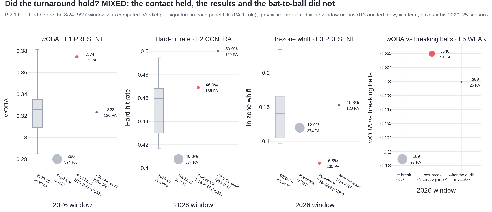
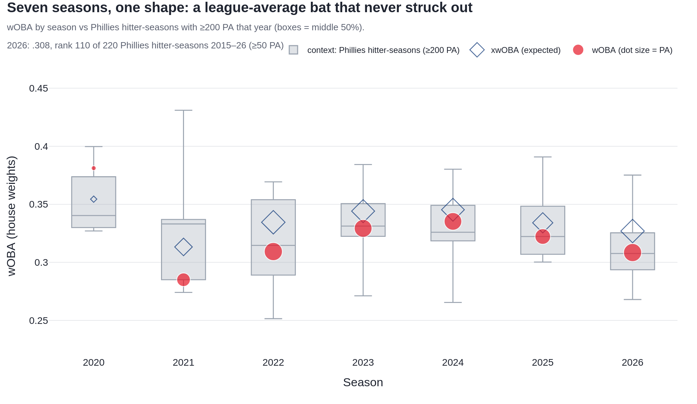
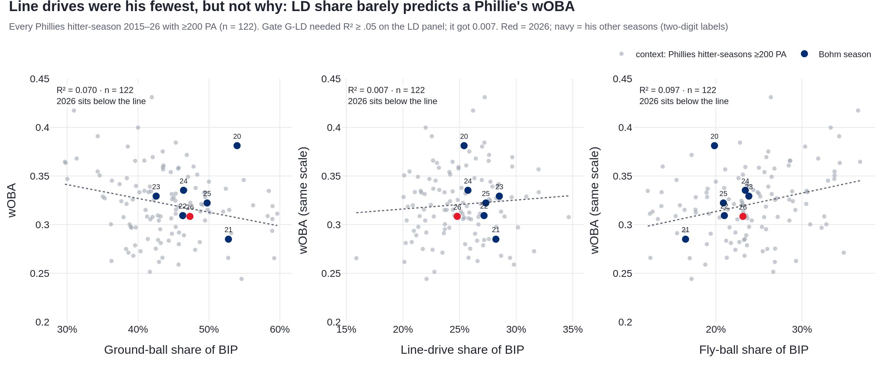
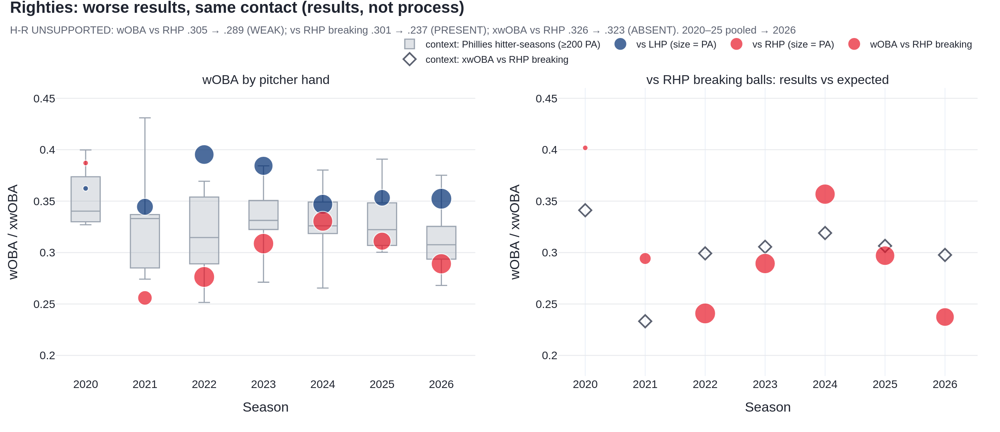
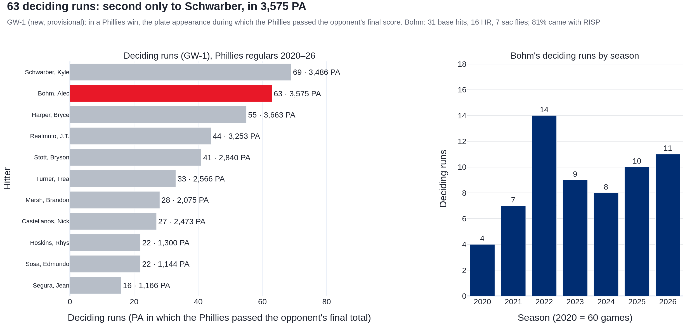
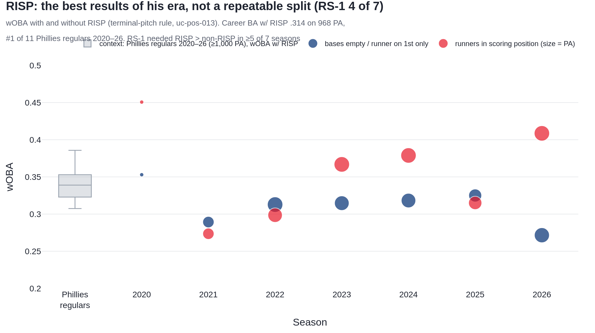
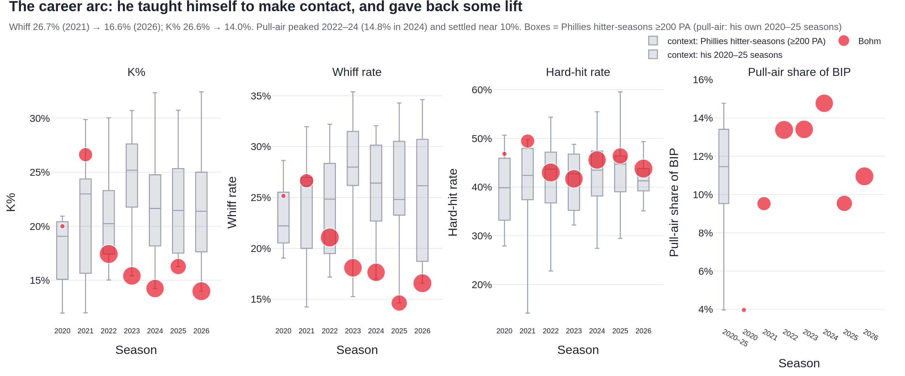

# Alec Bohm, Phillie
### UC #67 · `uc-pos-026` · `dp_uc67` v1.0.0 · Phillies Offense · regular season 2020–26 · anchor 2026-10-01
> **Data window & reliability.** House Statcast log through 2026-09-27 (last regular-season game), id-locked to MLBAM 664761, postseason excluded (receipted). 2026 = 629 PA in 153 games with a PA (155 appeared). Small cells print their PA. Pre-registered ledger filed 13:30 ET before any post-8/22 number was computed. DQ 11/0/0 · harness 51/51.
## The bottom line
**Bohm leaves as an average bat with an elite contact profile and the best run-scoring results of any Phillies regular of his era.** The second-half surge uc-pos-013 audited did not survive September in the results (wOBA .374 → .323), but the contact did (hard-hit 46.9% → 50.0%). The line-drive dip was real and explains almost nothing. The righty problem was results, not contact. He drove the deciding run in 63 Phillies wins, second only to Kyle Schwarber.

- **The finish (PR-1 H-F MIXED):** after the audit window, wOBA fell .374 → .323 and in-zone whiff went 6.8% → 15.3%, but hard-hit rose to 50.0% on 120 PA. Registered call: **it held in the contact, not in the results**.
- **2026 in context:** 629 PA, wOBA .308, rank 110 of 220 Phillies hitter-seasons since 2015 (50th percentile). K% 14.0% ranks 13th-lowest. April (.182 wOBA, 98 PA) cost the season.
- **Line drives (H-LD SUPPORTED, gate G-LD fails):** 24.8% of balls in play, his lowest of seven seasons, but the Phillies median (rank 108 of 220). Across 122 Phillies hitter-seasons, LD share explains 0.7% of wOBA. Not the story.
- **Righties (H-R UNSUPPORTED):** wOBA vs RHP .305 → .289, vs RHP breaking .301 → .237, but xwOBA vs RHP .326 → .323. **Results, not process.**
- **Runners in scoring position:** career BA w/ RISP .314 on 968 PA, #1 of 11 Phillies regulars 2020–26; 2026 RISP wOBA .409 vs .272 otherwise. But RS-1 fails (4 of 7 seasons): the best results of his era, not a repeatable split.
- **Deciding runs (GW-1):** 63 in 3,575 PA, #2 behind Schwarber (69 in 3,486). 11 in 2026. 31 base hits, 16 HR, 7 sac flies; 81% with a runner in scoring position.

## 1 · The 2026 finish: did the turnaround hold?
uc-pos-013 closed on 2026-08-22 with Bohm at a .374 wOBA since the break and asked whether it was real. The organization filed five signatures before computing anything after that date. The answer is split. The results and the in-zone contact went back toward his pre-break self. The quality of contact did not: September had the hardest contact of his season.

| Window | Dates | PA | wOBA | Hard-hit | In-zone whiff | xwOBAcon | wOBA vs breaking (PA) | BA w/ RISP (PA) | Runs on watch / PA |
|---|---|---|---|---|---|---|---|---|---|
| Pre-break | 03-26–07-12 | 374 | .280 | 40.8% | 12.0% | .313 | .189 (97) | .299 (92) | .131 |
| Post-break, audited | 07-16–08-22 | 135 | .374 | 46.9% | 6.8% | .404 | .340 (51) | .462 (42) | .207 |
| After the audit | 08-24–09-27 | 120 | .323 | 50.0% | 15.3% | .364 | .299 (25) | .321 (36) | .108 |

**Scored (PA-1 rule, bars set in the BID):** wOBA PRESENT, hard-hit **CONTRA** (it rose), in-zone whiff PRESENT, xwOBAcon WEAK, breaking-ball wOBA WEAK → H-F **MIXED** → **it held in the contact, not in the results**. The September line (.323) still sat above his pre-break .280. He ended between the two hitters uc-pos-013 described, not back at the first one. What came back was the in-zone miss (15.3%, higher than any full season of his since 2022). That is the signature uc-pos-013 leaned on hardest.

## 2 · 2026 against his Phillies career
Seven seasons look like one hitter: around the Phillies median in wOBA every year since 2021, with strikeout and whiff rates near the best in the pool. 2026 was his second-worst season, and almost all of the damage was done in April.

| Season | PA | Slash | wOBA | Luck gap | K% | Whiff | Hard-hit | LD | Pull-air | Runs on watch | BA w/ RISP (PA) |
|---|---|---|---|---|---|---|---|---|---|---|---|
| 2020 | 180 | .338/.400/.481 | .381 | +.036 | 20.0% | 25.2% | 46.8% | 25.4% | 4.0% | 26 | .452 (52) |
| 2021 | 417 | .247/.305/.342 | .285 | −.012 | 26.6% | 26.7% | 49.5% | 28.2% | 9.5% | 52 | .260 (112) |
| 2022 | 631 | .279/.314/.397 | .309 | −.005 | 17.4% | 21.1% | 43.0% | 27.2% | 13.4% | 78 | .281 (155) |
| 2023 | 610 | .274/.326/.437 | .329 | −.007 | 15.4% | 18.1% | 41.7% | 28.5% | 13.4% | 99 | .344 (171) |
| 2024 | 604 | .280/.329/.448 | .335 | −.001 | 14.2% | 17.6% | 45.6% | 25.7% | 14.8% | 98 | .301 (170) |
| 2025 | 504 | .287/.331/.409 | .322 | +.007 | 16.3% | 14.6% | 46.4% | 27.3% | 9.5% | 61 | .285 (138) |
| **2026** | 629 | .249/.315/.383 | .308 | −.007 | 14.0% | 16.6% | 43.8% | 24.8% | 11.0% | 90 | .347 (170) |

*Luck gap = Statcast-basis wOBA − xwOBA (same basis). 2020 = 60-game season. TP-1 applied: the 2026 log line equals the public line (REC-1).*

**2026 among 220 Phillies hitter-seasons since 2015 (≥50 PA):** wOBA rank 110 (50th pct) · K% 13 (94th) · whiff 17 (92th) · hard-hit 46 (79th) · chase 61 (72th). The season was lost in April (.182 wOBA, 98 PA; CI-4: .159/.227/.206 through 35 games). From May on, every month sat at .294 or better.

## 3 · The line-drive question
The client's hunch is right as a description. He hit his fewest line drives. The registered gate asked whether that matters for a Phillie's wOBA, and across 122 hitter-seasons it barely does.

| Signature | 2020–25 | 2026 | Verdict |
|---|---|---|---|
| LD share of BIP | 27.2% | 24.8% | PRESENT |
| LD share vs RHP | 27.7% | 25.1% | PRESENT |
| LD share vs RHP breaking | 24.3% | 27.0% | ABSENT |

H-LD is **SUPPORTED**: line drives fell overall (24.8%, his lowest of seven seasons) and against righties, but *rose* against right-handed breaking balls. **Gate G-LD failed:** across 122 Phillies hitter-seasons (≥200 PA), LD share explains R² = 0.007 of wOBA, against a registered bar of .05. Fly-ball share explains more (0.097), ground-ball share 0.070. By the registered rule the line-drive angle is **not** the story. The LD spray chart (house field outline) ships in the dashboard as context, not here. It shows his line drives going up the middle more (straightaway 37% vs 27%) and falling for hits at a similar rate (.617).

## 4 · Righties and righty spin
The platoon gap is real and old: he has hit lefties better every season since 2021. In 2026 the outcomes against right-handed breaking balls were his worst, but the expected line did not move. Most of the missing hits were on balls the client's xBA > .500 rule does not look at.

| vs RHP breaking | PA | wOBA | xwOBA | Hard-hit | Barrel | LD | xBA>.500 → hit (XC-1) | Whiff |
|---|---|---|---|---|---|---|---|---|
| 2020 | 37 | .402 | .341 | 58.3% | 12.5% | 29.2% | 9/10 = 90% | 42.4% |
| 2021 | 69 | .294 | .233 | 38.3% | 2.1% | 19.1% | 9/10 = 90% | 31.4% |
| 2022 | 153 | .241 | .299 | 39.5% | 6.1% | 25.4% | 21/33 = 64% | 29.9% |
| 2023 | 147 | .289 | .306 | 29.3% | 3.4% | 27.6% | 27/31 = 87% | 24.1% |
| 2024 | 147 | .357 | .319 | 40.9% | 6.1% | 25.2% | 28/37 = 76% | 24.5% |
| 2025 | 138 | .297 | .306 | 33.3% | 6.1% | 19.2% | 17/26 = 65% | 25.2% |
| 2026 | 128 | .237 | .298 | 43.0% | 6.0% | 27.0% | 22/29 = 76% | 23.0% |

H-R **UNSUPPORTED** (R1 WEAK, R2 PRESENT, R3 ABSENT) → **results, not process**. Against right-handed breaking balls 2026 had his best hard-hit rate since 2020 and an unchanged xwOBA (.298 vs .301 pooled wOBA before). The outcome (.237) is his worst, by .003 over 2022. The client's luck test (xBA > .500) puts 2026 mid-pack, 4th of 7. The gap sits in the ordinary balls under that line, which is where a .237 / .298 split comes from.

## 5 · Run creation and runners in scoring position
This is the case for Bohm, and it is a strong case on results. The runs happened while he was at the plate, more than for almost any other Phillie. What the data cannot show is that he had a repeatable gift for it.

| Phillies regulars 2020–26 (≥1,000 PA) | PA | Deciding runs (GW-1) | Runs on watch | BA w/ RISP (PA) | RISP lift (wOBA) |
|---|---|---|---|---|---|
| Schwarber, Kyle | 3,486 | 69 | 546 | .247 (793) | +.021 |
| **Bohm, Alec** | 3,575 | 63 | 504 | .314 (968) | +.044 |
| Harper, Bryce | 3,663 | 55 | 524 | .294 (825) | +.001 |
| Realmuto, J.T. | 3,253 | 44 | 418 | .238 (876) | −.022 |
| Stott, Bryson | 2,840 | 41 | 313 | .272 (707) | +.024 |
| Turner, Trea | 2,566 | 33 | 273 | .272 (563) | −.031 |
| Marsh, Brandon | 2,075 | 28 | 249 | .268 (540) | +.010 |
| Castellanos, Nick | 2,473 | 27 | 336 | .270 (654) | +.007 |
| Sosa, Edmundo | 1,144 | 22 | 161 | .276 (322) | +.021 |
| Hoskins, Rhys | 1,300 | 22 | 180 | .256 (307) | −.005 |
| Segura, Jean | 1,166 | 16 | 126 | .290 (281) | +.021 |

*GW-1: in a Phillies win, the plate appearance during which the Phillies passed the opponent's final score. Runs on watch: every run that scored during his PA (K48). RISP lift = wOBA with RISP − without.*

Bohm ranks #2 in deciding runs, #3 in runs on watch, and **#1** in both BA with RISP (.314) and RISP lift (+.044) among these 11. He decided 63 of the 566 Phillies wins in his tenure (11.1%). CI-3 frames it the way the front office does: “those 90 runs he drives in every year will be missed.”

**RS-1 failed (4 of 7; bar 5).** His RISP lift was negative in 2021, 2022, 2025. 2026 was the extreme (+.137: .409 with RISP, .272 without). That is how a noisy split behaves. The results were real runs; the repeatable skill underneath is the contact profile in §2, which plays in every base state.

## 6 · The Phillies career, closed
The arc of the career is a contact education: whiff rate down by ten points from 2021. He gave back some of the pull-side lift he found in 2022–24. He leaves at 30 without a qualifying offer.

3,575 PA as a Phillie (#2 among regulars 2020–26). Whiff 26.7% → 16.6% and K% 26.6% → 14.0% from 2021 to 2026. Pull-air peaked at 14.8% in 2024. The 2023–24 version (.329 and .335 wOBA, 99 and 98 runs on watch) is the hitter the club will miss. The 2026 version is the one the market will price.

| Carry-in | Fact (never computed on) | Source |
|---|---|---|
| CI-1 | 2026 line .249/.315/.383, 15 HR, 29 2B, 88 RBI, 155 G; $10.2M 2026 salary | NBC Sports Philadelphia / MLB.com free-agency profile, Oct–Nov 2026 |
| CI-2 | Phillies did not extend the $23.15M qualifying offer; Bohm entered free agency without draft-pick compensation | NBC Sports Philadelphia, Nov 2026 |
| CI-3 | Dombrowski, end-of-season press conference: “those 90 runs he drives in every year will be missed” | NBC Sports Philadelphia |
| CI-4 | Through 35 games: .159/.227/.206, .171 BABIP | MLB.com free-agency profile, 2026-10-09 |
| CI-5 | Moved to first base after the Arraez acquisition (log: 106 games at 3B, 50 at 1B) | NBC Sports Philadelphia; log fielder columns |
| CI-6 | NL Wild Card Series loss to Atlanta; go-ahead HR in Game 2 (postseason excluded from every rate here) | MLB.com |

## 7 · Claims graded, and what this product does not claim
| HP | Claim | Verdict | Result |
|---|---|---|---|
| HP-01 | Game-winning cell reproduces | **CONFIRMED** | client 11 rows / 11 games vs GW-1 11; career 63 vs 63; 0 non-terminal-pitch rows |
| HP-02 | Bohm did not hit enough line drives in 2026 | **CONFIRMED** | H-LD SUPPORTED (L1 PRESENT, L2 PRESENT, L3 ABSENT); G-LD R² 0.007 on n = 122 |
| HP-03 | Solid against lefties, struggled against righties too much in 2026 | **PARTLY** | vs LHP 0.3524 vs bar 0.3510 (met); vs RHP 0.289 ranks 3 lowest of 7 |
| HP-04 | vs RHP: hard-hit consistent, barrel mostly fine, LD sank a bit | **CONFIRMED** | HH 0.446 in [0.413, 0.522]; barrel 0.049 in [0.041, 0.086]; LD 0.251 vs 0.277 |
| HP-05 | vs RHP: more ground balls, but not a ton more | **CONFIRMED** | 0.508 vs 0.488 = +2.0 pts |
| HP-06 | He stopped being able to hit righty breaking balls | **CONFIRMED** | 2026 0.237 (128 PA); lowest season = 2026 (0.237); xwOBA 2026 0.298 vs 2020-25 0.302 |
| HP-07 | vs RHP breaking 2026: hard-hit highest since 2020, barrel just under 6%, LD in line | **CONFIRMED** | HH 0.430 rank 1 of 6; barrel 0.0600; LD 0.270 vs 0.243 |
| HP-08 | Not an overtly unlucky year: 76% of xBA > .500 BIP became hits (vs RHP breaking) | **CONFIRMED** | 22/29 = 0.759; rank 4 of 7 (1 = luckiest) |
| HP-09 | uc-pos-013 §6 career table (parent UC, our own) | **NOT CONFIRMED (parent defect)** | 4 of 6 completed seasons differ (2022: +64, 2023: +53, 2024: +15, 2025: +16); 2 exactly equal to that season's postseason PA |

1. Every rate is regular season, id-locked (MLBAM 664761). TP-1: the inherited house PA rule counted Statcast `truncated_pa` rows as PA and AB (4 for Bohm, 3 in 2026); this build treats them as non-terminal, which reproduces the public 2026 line exactly (.249/.315/.383, REC-1). uc-pos-013's pre-break window carried the 3 phantom PA.
2. The after-the-audit window is 120 PA (2026-08-24–2026-09-27); the breaking-ball cell inside it is 25 PA. Read direction, not decimals.
3. PR-1 bars were filed at 13:30 ET before any post-8/22 number was computed. H-LD L1/L2 and H-R R1/R2 were client-seen (the client's notebook) and are labelled so.
4. GW-1 (deciding run) is new and provisional. It credits the batter at the plate when the decisive run scores, whatever the mechanism; it is not RBI, which is a carry-in only.
5. Runs on watch (K48 `runs_created`) counts every run that scored during his plate appearances, including his own on a homer and runs on wild pitches. It is not Bill James runs created.
6. House wOBA (FanGraphs weights) sits a little below Statcast-basis xwOBA in most seasons. Luck is read only on the same basis (WB-1 − XW-1), never house wOBA − xwOBA.
7. Ranks are within the Phillies frame (2015–26), never MLB-wide. 2020 is a 60-game season, counted and labelled.
8. The departure is the client's stated assumption plus carry-ins CI-2 and CI-3. No contract, market or roster recommendation is made.

*Receipts: `out/dp_uc67_*` · build `dp_uc67_bohm_recap.py` · harness `dp_uc67_verification.py` · governance trail `Agents for Data Products/data-products/uc-pos-026-bohm-career-retrospective-001/` · Data Product Owner: Kellen Short.*
