# Still Zack Wheeler — 2026
### Season recap · RHP · Philadelphia Phillies · 28 starts + Wild Card Game 3 · data through 2026-09-27

**Prepared for:** pitching department · front office · broadcast and content · Zack Wheeler

**Arsenal (2026):** four-seam 35.7% · splitter 16.3% · sinker 15.5% · sweeper 13.4% · cutter 10.5% · curveball 8.7%

**Governance:** Use Case #51 (`uc-pps-035`) · build `dp_uc51` v1.0.0 · kernel `dp_uc51_kernel.py` imports `dp_uc49_kernel` (sha256 `a4ad5191…`) and `dp_uc50_kernel` (`8084cb17…`), and extracts three governed functions by pinned source: `edge_rate` (UC8), `jam_rate` (house library, 10/9) and `release_consistency` (UC28). The October card rule (OC-1) is on its second use. New objects (CF-2b, OU-2, GS-1b, ST-1, NC-1, MX-1, SR-2, IX-1) are provisional. Independently verified; see `05_quality_certification.md`.

**Companion:** `dp_uc51_wheeler_2026_dashboard.html`, the same story in eight chapters with a start-by-start drill.

> ⚠️ **Read this first: data window, sources, carry-ins.**
>
> - **Entity lock:** MLBAM 554430, never a name filter. Regular season for every rate. The Wild Card outing and his earlier Octobers appear only in §8.
> - **Sources:** the Phillies log 2020–2026 (regular season anchored 2026-09-27, Game 162) and `data/opponents/wheeler.parquet` (Mets 2017–19, context only). His pitches also sit in 23 other opponent files; the career frame de-duplicates them by pitch key. **148 Lehigh Valley rehab pitches** (3/28, 4/3, 4/8) are tagged as regular season in `lhvp26.parquet`; they are excluded here (MI-1).
> - **House percentiles and ranks** are Phillies pitcher-seasons, 2015–2026. They are **not MLB-wide**.
> - **"Runs on watch"** are runs that scored during the plate appearances he threw. They include unearned runs; this is not ERA. **Outs** come from OU-2 (the outs sequence of the full defensive log), which reconciles to the published 162.0 IP; the older event-map method (OU-1) finds 480 of the 486 outs.
> - **Tied-up rate** is a public-data proxy for Baseball Savant's swing-timing bucket (house `jam_rate`, intercept < 32.5 in). Savant's own edge (42.4%) and xwOBA (.263) are quoted from your notebook and reconciled, never substituted.
> - **Carry-ins, never computed on:** 2025 ended after 8/15/2025 with a blood clot; venous thoracic outlet syndrome; first-rib resection 9/23/2025 (MLB.com 8/2025, Inquirer 9/19/2026). Three-year, $126M extension signed March 2024, one year left (Inquirer). Season line 14–5, 3.00 ERA, 162.0 IP, 193 K, 47 BB (StatMuse). A six-start post-break slide with an 8.51 ERA, blamed on a dropped glove and over-rotation, since fixed (Inquirer). Wild Card G3: four innings of relief, two runs, Braves 6–2 (FOX 29, 10/1).
> - **The body.** The log shows velocity, release point and location. It does not show an injury or a glove, and nothing here infers either.

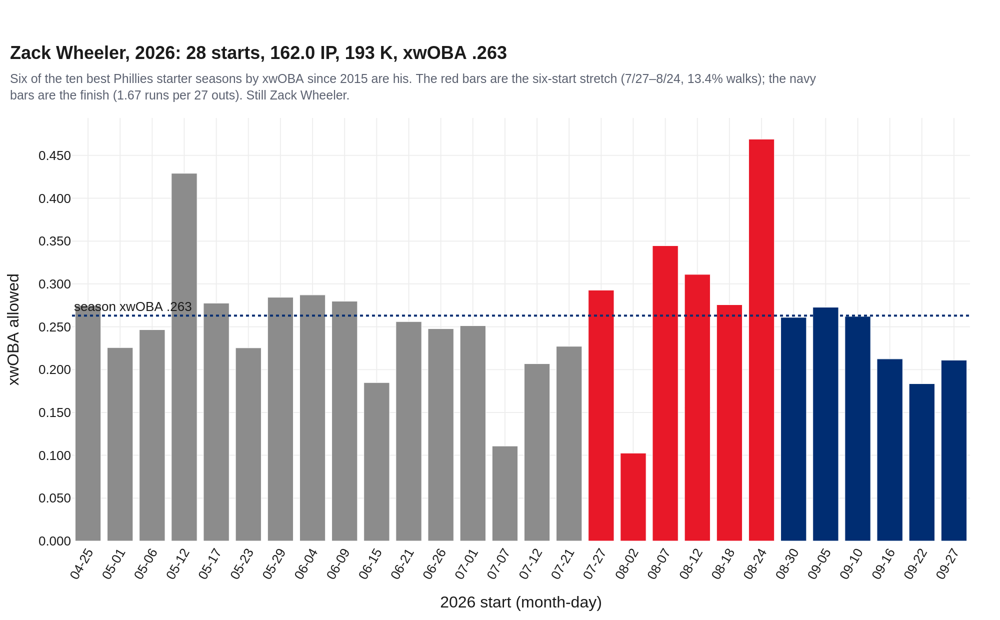

---

## Bottom line

1. **He is still Zack Wheeler.** His .263 xwOBA (your Savant number exactly) is #6 of 41 Phillies seasons with a starter's workload since 2015, and **6 of the top ten are his**. K-BB 22.6% ranks #6. He threw 162.0 innings in 28 starts after a rib resection.
2. **The walk rate is six starts, not a season.** His 7.3% walk rate is the highest of his seven Phillies seasons. Almost all of it came from 7/27 to 8/24: 13.4% (16 walks in 119 PA) against 5.9% in his other 22 starts (p = 0.004). That window, and only that window, reconciles to the reported 8.51 ERA. Over the last six starts he walked 6.2% and allowed 1.67 runs per 27 outs.
3. **The log is consistent with a delivery problem that got fixed, and it cannot prove one.** During the slide, his clear misses went to the arm side 25.5% of the time against 17.8% otherwise (p = 0.033), then fell to 12.3% in the finish. His four-seam release point, extension and release consistency did not move.
4. **Your instinct on the zone was the biggest finding.** In-zone rate fell to 42.1% (2021–25: 50.2%, p < .001), the lowest of his Phillies years, and hitters chased 36.2%, the highest. Edge rate did not move. Contact quality was noise, as you said: hard-hit, barrel and line-drive rates all sit inside his range (every p > .4).
5. **For 2027, the bar is written down first.** The Still-Wheeler card sets four bars from his own 2026 starts. On-script starts in 2026 allowed 2.16 runs per 27 outs and off-script starts 4.96; the finish was 6/6 on-script. His Wild Card relief outing, graded after the fact, was off-script: 17.6% walks and 8.8 whiffs per 100 pitches.

---

## 1 · The return

| Season | G | PA | wOBA | xwOBA | OPS | K% | BB% | Hard-hit | Barrel | LD | Tied-up | FF mph |
|---|---|---|---|---|---|---|---|---|---|---|---|---|
| 2020 | 11 | 286 | .290 | .289 | .656 | 18.5% | 4.9% | 34.0% | 3.8% | 27.4% | — | 96.9 |
| 2021 | 32 | 849 | .255 | .257 | .582 | 29.1% | 5.3% | 28.5% | 4.6% | 24.3% | — | 97.2 |
| 2022 | 26 | 608 | .274 | .275 | .622 | 26.8% | 5.4% | 34.5% | 7.7% | 24.3% | — | 95.9 |
| 2023 | 32 | 787 | .278 | .278 | .638 | 26.8% | 5.0% | 36.4% | 5.1% | 23.7% | — | 95.8 |
| 2024 | 32 | 788 | .256 | .266 | .580 | 28.4% | 6.6% | 33.6% | 8.3% | 20.9% | — | 95.3 |
| 2025 | 24 | 587 | .262 | .253 | .600 | 33.2% | 5.6% | 34.1% | 7.2% | 23.8% | 33.0% | 96.1 |
| **2026** | **28** | **645** | **.278** | **.263** | **.630** | **29.9%** | **7.3%** | **35.2%** | **6.0%** | **23.2%** | **32.0%** | **95.2** |

*2020 was a 60-game season (286 PA). Tied-up rate needs bat tracking, which begins in 2025.*

His 2025 stopped after August 15. The 2026 log starts on April 25, after three rehab starts at Lehigh Valley. The first half was already certified: `uc-pps-020` published 15 starts, 92.0 IP, a .246 wOBA, a 30.4% K rate, a 6.2% walk rate and a 36.2% chase rate through July 12. This recap recomputes all six before adding anything (**6/6**). The published season line (14–5, 3.00 ERA, 162.0 IP, 193 K, 47 BB) reconciles to the log on innings, strikeouts and walks.

## 2 · Still Zack Wheeler

| KPI | 2026 | House percentile | Rank, 2015–26 | Rank, 2026 staff |
|---|---|---|---|---|
| xwOBA | .263 | 90th | #18 of 198 | #4 of 15 |
| wOBA | .278 | 78th | #39 of 198 | #4 of 15 |
| K rate | 29.9% | 88th | #23 of 198 | #4 of 15 |
| K-BB | 22.6% | 87th | #24 of 198 | #4 of 15 |
| BB rate | 7.3% | 53th | #88 of 198 | #6 of 15 |
| Whiff rate | 30.9% | 82th | #34 of 198 | #5 of 15 |
| Chase rate | 36.2% | 95th | #7 of 198 | #2 of 15 |

*House population: 198 Phillies pitcher-seasons with ≥100 PA, 2015–2026. 2026 staff: 15 pitchers.*

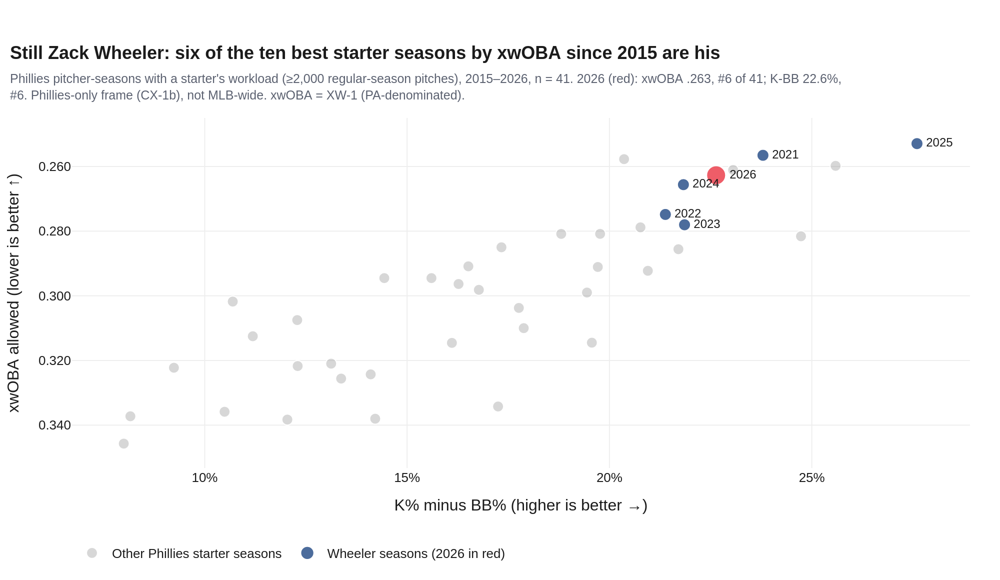

Read the board two ways. Against the room, 2026 sits in the top-right corner with his own best seasons. Against himself, 2026 is a step behind 2025 and 2021 on both axes and just ahead of 2024. That is what "for now he is still Zack Wheeler" looks like in numbers.

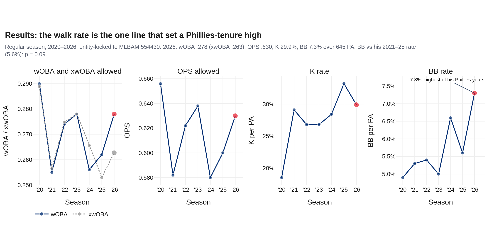

## 3 · He stopped needing the zone

| Rate | 2026 | 2025 | p vs 2025 | 2021–25 pooled | p vs 2021–25 |
|---|---|---|---|---|---|
| In-zone (tracked) | 42.1% | 50.1% | 0.000 | 50.2% | 0.000 |
| Chase (swings / out-of-zone) | 36.2% | 31.2% | 0.006 | 32.1% | 0.002 |
| Edge (ER-1) | 36.0% | 35.5% | 0.707 | 36.9% | 0.390 |
| BB per PA | 7.3% | 5.6% | 0.236 | 5.6% | 0.089 |
| K per PA | 29.9% | 33.2% | 0.213 | 28.7% | 0.541 |
| Hard-hit per BIP | 35.2% | 34.1% | 0.760 | 33.3% | 0.457 |
| Barrel per BIP | 6.0% | 7.2% | 0.515 | 6.4% | 0.732 |
| Line drive per BIP | 23.2% | 23.8% | 0.849 | 23.3% | 0.946 |

*Pooled two-proportion z-test (house standard). In-zone uses tracked pitches as the denominator.*

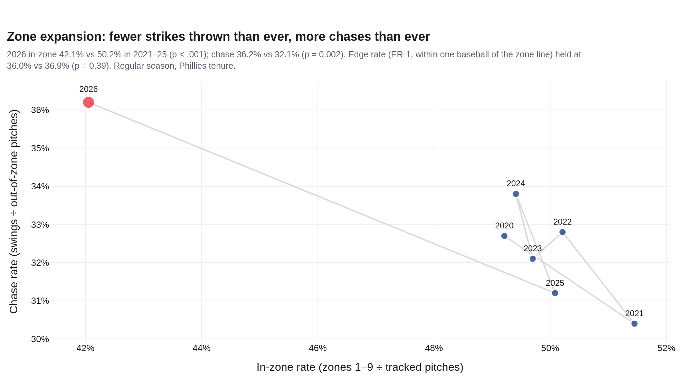

The largest change of his season is where he threw the ball, not how hard. Eight points fewer pitches in the zone than his 2021–25 rate, and the most chases of his Phillies years. The splitter is the engine (§7): 16.3% of his pitches, mostly below the zone, with a 45.5% whiff rate.

**Edge rate.** Your note quotes Savant: *"Wheels was edging us 42.4% of the time."* The house edge rate (ER-1, from `uc-pps-008`) counts pitches whose centre is within one baseball of the rulebook zone line, and gives 36.0%. Savant draws its edge band differently, so the two numbers measure different areas and should not be compared. On ER-1, 2026 is ordinary for him (p = 0.39 against 2021–25). Throwing fewer strikes did not mean throwing fewer competitive pitches.

## 4 · The six-start slide

Reporting described *"an 8.51 ERA over six starts"* after the All-Star break. The log has eight runs of six consecutive post-break starts. Exactly one of them allowed 8.51 runs on watch per 27 outs:

| Six starts | Runs on watch per 27 outs |
|---|---|
| 2026-07-21 → 2026-08-18 | 5.60 |
| 2026-07-27 → 2026-08-24 | **8.51** |
| 2026-08-02 → 2026-08-30 | 6.26 |
| 2026-08-07 → 2026-09-05 | 5.75 |
| 2026-08-12 → 2026-09-10 | 4.91 |
| 2026-08-18 → 2026-09-16 | 3.34 |
| 2026-08-24 → 2026-09-22 | 3.53 |
| 2026-08-30 → 2026-09-27 | 1.67 |

That is the slide: 7/27 to 8/24. It is identified by reconciliation, not chosen because it looks bad, and the build asserts the match (DQ-30).

| Period | Starts | PA | BB% | K% | wOBA | xwOBA | In-zone | Edge | Arm-side misses | Runs / 27 outs |
|---|---|---|---|---|---|---|---|---|---|---|
| First half (4/25–7/12) | 15 | 355 | 6.2% | 30.4% | .245 | .254 | 42.6% | 36.6% | 19% | 2.03 |
| Post-break opener (7/21) | 1 | 25 | 0.0% | 36.0% | .239 | .227 | 51.6% | 39.8% | 27% | 2.57 |
| **The slide (7/27–8/24)** | 6 | 119 | 13.4% | 26.1% | .434 | .331 | 39.7% | 33.5% | 26% | 8.51 |
| The finish (8/30–9/27) | 6 | 146 | 6.2% | 30.8% | .238 | .235 | 41.2% | 36.0% | 12% | 1.67 |

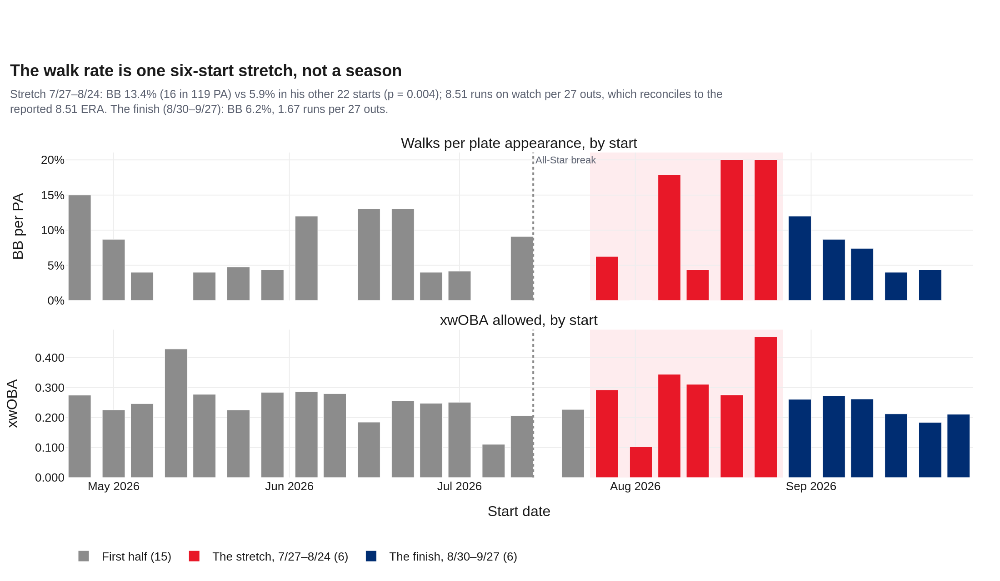

**What changed in the slide:** walks (13.4% vs 5.9%, p = 0.004) and the direction of his misses. **What did not:** strikeouts (26.1% vs 30.8%, p = 0.31), chase (p = 0.39), in-zone (p = 0.24), the share of clear misses (29.7% vs 29.2%, p = 0.82) and the delivery measures below.

| Four-seam, start means | Slide | Other starts | Starts | p (Welch) |
|---|---|---|---|---|
| FF release x (ft) | -1.88 | -1.83 | 6 / 22 | 0.28 |
| FF release height (ft) | 4.97 | 5.00 | 6 / 22 | 0.31 |
| FF extension (ft) | 7.24 | 7.25 | 6 / 22 | 0.89 |
| Release consistency RCI (in) | 0.96 | 0.95 | 5 / 22 | 0.93 |
| FF velocity (mph) | 94.7 | 95.3 | 6 / 22 | 0.14 |

*Arm angle is published by Statcast for only 56% of his 2026 four-seams (one slide start has it), so it is not tested.*

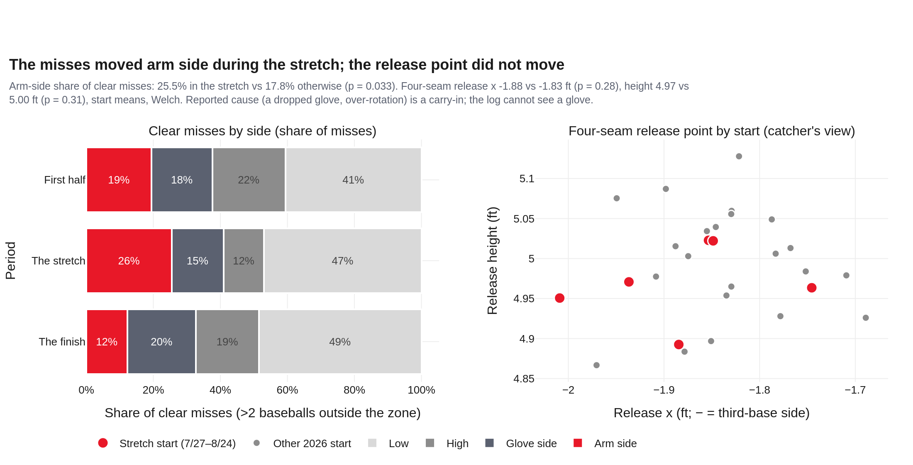

The reported cause was a mechanical flaw: dropping the glove and over-rotating. The log is consistent with that story in one way: the misses that were clearly out of the zone drifted to his arm side during the slide and came back after it. It is silent in another: the four-seam left his hand from the same place throughout. A glove and a rotation are not in the data. What the data says is that he missed the same amount, missed in a different direction, walked people for six starts, and stopped.

## 5 · Contact and swing timing

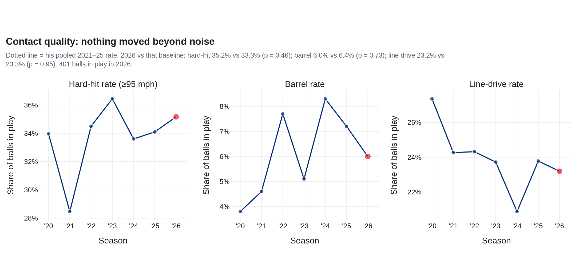

Your read holds: fewer barrels, no surge in line drives or hard contact, and none of the three is distinguishable from his normal. Hard-hit rate is the second-highest of his Phillies years (35.2%) without being a real change (p = 0.46).

**Tied-up rate.** Hitters were tied up on 32.0% of his 1,304 tracked swings (42.9% centered, 25.2% flail; 2025: 33.0% tied up). Among 45 Phillies pitcher-seasons in 2025–26 with at least 50 tracked swings, that is #11 (mean 29.3%); among the 14 with at least 500, #6. The leader is José Alvarado (44.8%). Good, not the top of the room.

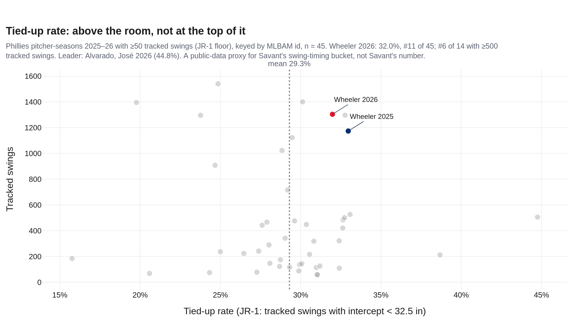

The signature is the sinker in on right-handed hitters. 124 of their swings at it were tied up; 55 of those went in play, for 14 hits, an average exit velocity of 75.8 mph and 56% ground balls. Your notebook counted 57; the difference is Wild Card rows (§9, HP-10). A foul bunt is not counted as a swing (JR-1).

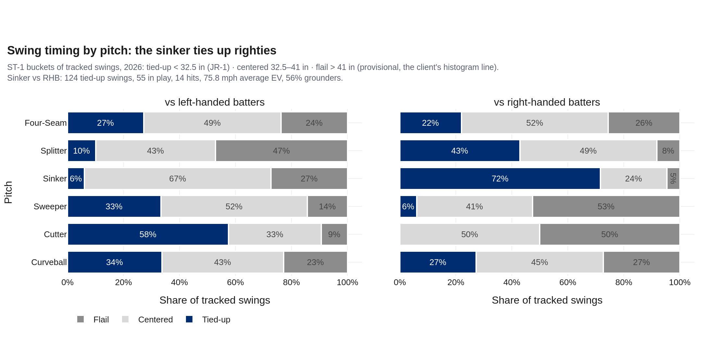

## 6 · Lefties did the damage

| 2026 | PA | wOBA | xwOBA | K% | BB% | Hard-hit | Barrel | Tied-up |
|---|---|---|---|---|---|---|---|---|
| vs RHB | 266 | .242 | .229 | 31.6% | 5.3% | 25.7% | 5.4% | 37.8% |
| vs LHB | 379 | .304 | .287 | 28.8% | 8.7% | 41.9% | 6.4% | 28.4% |

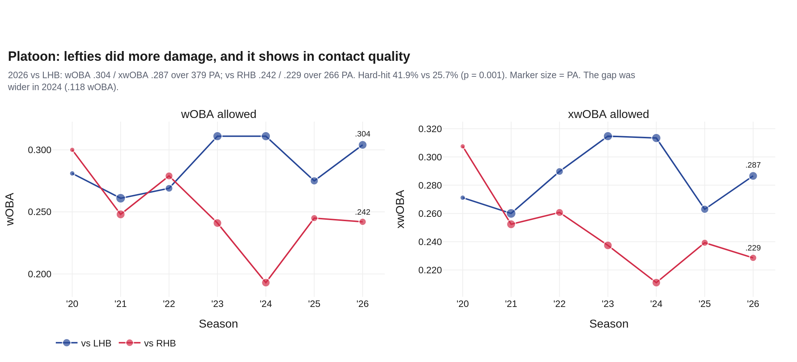

Right-handed hitters were helpless: a .242 wOBA, a 5.3% walk rate and 37.8% of their swings tied up. Lefties hit him harder: 41.9% hard-hit against 25.7% (p = 0.001), and they walked more (8.7% vs 5.3%, p = 0.10). The split is real and familiar: it was wider in 2024 (.118 wOBA) and nearly absent in 2021–22.

## 7 · Six pitches, the splitter second

| Pitch | Usage 2025 → 2026 | mph 2026 | Whiff 2026 | xwOBAcon 2026 | RV/100 2026 |
|---|---|---|---|---|---|
| Four-seam | 41.0% → 35.7% | 95.2 | 30.0% | .353 | +1.0 |
| Splitter | 8.9% → 16.3% | 87.4 | 45.5% | .333 | +1.3 |
| Sinker | 17.0% → 15.5% | 94.8 | 10.8% | .306 | +1.8 |
| Sweeper | 14.8% → 13.4% | 81.3 | 37.6% | .352 | -0.2 |
| Cutter | 8.6% → 10.5% | 90.9 | 21.4% | .338 | +0.4 |
| Curveball | 9.8% → 8.7% | 80.0 | 45.8% | .304 | +0.9 |

*RV/100 = run value per 100 pitches, pitcher's view (positive is good for him).*

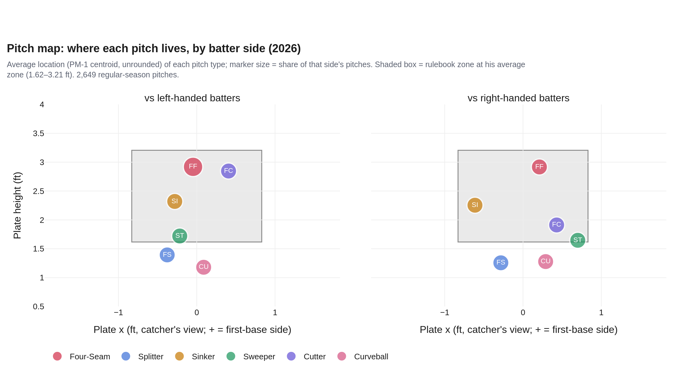

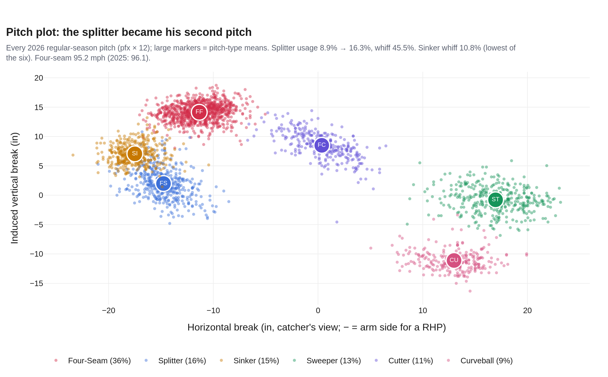

The four-seam averaged 95.2 mph, the slowest of his Phillies years (2021: 97.2; 2025: 96.1). The carry-in figures reconcile: 96.5 in July 2025, 95.4 in September 2026. Velocity held within the season (95.3 first half, 95.2 second). The slowing is across years, and the splitter is how he has answered it.

## 8 · October, and 2027

**Wild Card Game 3, 10/1 at Atlanta.** Four days after Game 162, he entered in the 3rd after Aaron Nola's early exit: 4.0 IP, 3 H, 2 R, 3 BB, 3 K on 68 pitches. The runs came on Ozzie Albies's two-run homer in the 4th. Braves 6, Phillies 2. It was his 13th postseason game for the Phillies.

| Date | Round | Opp | Role | IP | H | R | BB | K | HR | Pitches | GS-1b |
|---|---|---|---|---|---|---|---|---|---|---|---|
| 2022-10-07 | Wild Card | STL | start | 6.1 | 2 | 0 | 1 | 4 | 0 | 96 | 76 |
| 2022-10-12 | Division Series | ATL | start | 6.0 | 4 | 3 | 1 | 5 | 0 | 79 | 62 |
| 2022-10-18 | LCS | SD | start | 7.0 | 1 | 0 | 1 | 8 | 0 | 83 | 86 |
| 2022-10-23 | LCS | SD | start | 6.0 | 3 | 1 | 0 | 8 | 1 | 87 | 69 |
| 2022-10-29 | World Series | HOU | start | 5.0 | 6 | 5 | 3 | 3 | 1 | 69 | 34 |
| 2022-11-05 | World Series | HOU | start | 5.1 | 3 | 0 | 1 | 5 | 0 | 70 | 69 |
| 2023-10-03 | Wild Card | MIA | start | 6.2 | 5 | 1 | 0 | 8 | 0 | 100 | 75 |
| 2023-10-09 | Division Series | ATL | start | 6.1 | 3 | 3 | 1 | 10 | 1 | 92 | 65 |
| 2023-10-16 | LCS | AZ | start | 6.0 | 3 | 2 | 0 | 8 | 1 | 81 | 66 |
| 2023-10-21 | LCS | AZ | start | 7.0 | 6 | 1 | 1 | 8 | 1 | 99 | 67 |
| 2023-10-24 | LCS | AZ | relief | 1.2 | 0 | 0 | 1 | 1 | 0 | 30 | 49 |
| 2024-10-05 | Division Series | NYM | start | 7.0 | 1 | 0 | 4 | 9 | 0 | 111 | 81 |
| 2026-10-01 | Wild Card | ATL | relief | 4.0 | 3 | 2 | 3 | 3 | 1 | 68 | 43 |

*Phillies postseason, 2022–2026: 281 PA, wOBA .212, K 28.5%. GS-1b = Game Score (Tango v2 form) on OU-2 outs; log-derived, not the published stat.*

**The Still-Wheeler card.** One year is left on his deal. The card writes down now, before a 2027 pitch, what still being this pitcher means in his own 2026 numbers. The rule is OC-1 from `uc-pps-034`, unchanged: a start is **on-script** when at least three of the four signatures hold.

| # | Signature | Holds when | 2027 bar (his 2026 edge) | 2026 median | Same rule on 2021–25 |
|---|---|---|---|---|---|
| OC-A | Arm: four-seam velocity over the first 15 pitches | at or above | 95.3 mph | 95.7 mph | 96.2 mph |
| OC-B | The chase: share of out-of-zone pitches swung at | at or above | 30.8% | 38.8% | 27.6% |
| OC-C | Swing-and-miss: whiffs per 100 pitches | at or above | 13.0 | 15.0 | 11.3 |
| OC-D | Control: walks per plate appearance | at or below | 12.0% | 4.6% | 8.0% |

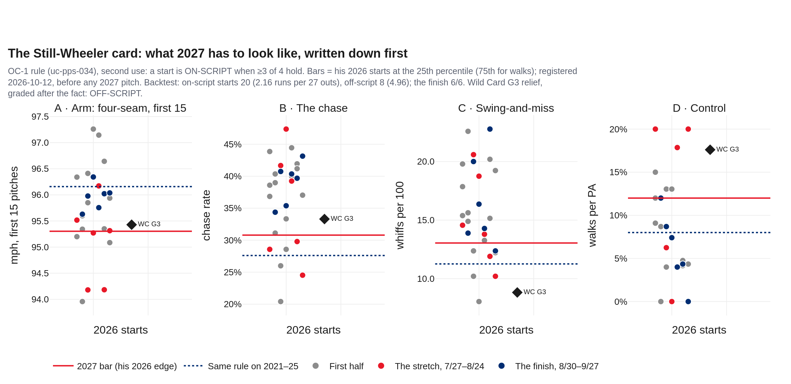

- **Backtest on 2026 (calibration, not prediction):** 20 on-script starts allowed 2.16 runs per 27 outs; 8 off-script starts allowed 4.96. By period: first half 10/15, the slide 3/6, the finish 6/6.
- **The bars moved.** Against his 2021–25 edge the 2026 bars are softer on velocity (95.3 vs 96.2 mph) and walks (12.0% vs 8.0%), and stricter on chase (30.8% vs 27.6%) and whiffs (13.0 vs 11.3 per 100). He gets outs differently now. 70% of his 146 starts from 2021–25 would pass the 2026 card.
- **Wild Card G3, graded after the fact:** arm and chase held; whiffs and walks slipped; OFF-SCRIPT. It is one relief outing on three days' rest, graded post hoc, and it counts for nothing except as an example of how the card reads.
- **How it is used:** grade every 2027 start as it posts (v1.1.0). Changing a bar after the first 2027 pitch is a breaking change.

## 9 · Your notebook, graded

| # | Your notebook said | Verdict | What the governed build shows |
|---|---|---|---|
| HP-01 | "It was the highest walk rate of Wheeler's time with the Phillies (7.6%)." | **SUPPORTED** | Highest of his seven Phillies seasons: 7.3% over 645 regular-season PA. The 7.6% reproduces exactly in your frame, which also holds the Wild Card outing (662 PA). Against his 2021–25 rate (5.6%) the season-level rise is not significant on its own (p = 0.09). |
| HP-02 | "This also felt like the theme during his struggles in August. He lost his previously elite command." | **SUPPORTED, SHARPENED** | The walks are six starts, 7/27–8/24: 13.4% (16 in 119 PA) vs 5.9% in his other 22 starts (p = 0.004). That window reconciles to the reported 8.51 ERA. He got it back: 6.2% over the last six starts. |
| HP-03 | "Most of the other results appear to just be noise. Fewer barrels, no huge surge in line drives or hard hits." | **SUPPORTED** | Against his 2021–25 baseline: barrel 6.0% vs 6.4% (p = 0.73); line drive 23.2% vs 23.3% (p = 0.95); hard-hit 35.2% vs 33.3% (p = 0.46). |
| HP-04 | "Pretty strong platoon splits. Elite against righties but lefties did more damage." | **SUPPORTED** | vs RHB .242 wOBA / .229 xwOBA; vs LHB .304 / .287. The damage is contact: hard-hit 41.9% vs 25.7% (p = 0.001). The gap was wider in 2024 (.118). |
| HP-05 | "xwOBA = .263, very good!" | **REPRODUCED** | XW-1 (inherited from uc-pos-018) gives .263, matching Savant. 90th house percentile of 198 Phillies pitcher-seasons; #6 of 41 starter workloads since 2015, and 6 of the top 10 are his. |
| HP-06 | "Edge rate (per Statcast Wheels was edging us 42.4% of the time)." | **DIFFERS: DEFINITION** | The house edge rate (ER-1, uc-pps-008: centre within one baseball of the zone line) is 36.0%. Savant's edge band is drawn differently, so 42.4% is a carry-in, not a receipt. On either definition it is not what moved: ER-1 vs 2021–25 p = 0.39. |
| HP-07 | "Edge rate would be a good one to double click on, as well as zone expansion." | **SUPPORTED: ZONE** | Zone expansion is the year's largest change: in-zone 42.1% (lowest of his Phillies years; 2021–25 50.2%, p < .001) and chase 36.2% (highest; p = 0.002). |
| HP-08 | "It is not called jam rate, it is called tied-up rate." | **ADOPTED** | Published as tied-up rate, computed by the library's governed jam_rate (JR-1, 10/9), inherited by source-pinned extraction. Centered and flail are added (ST-1, provisional) using your second histogram line (41 in). |
| HP-09 | "Wheeler's jam rates are really good per Statcast." | **PARTLY** | 32.0% tied-up, #11 of 45 Phillies pitcher-seasons 2025–26 (mean 29.3%); #6 of 14 with ≥500 tracked swings. Good, not the top of the room. Against righties it is 37.8%. |
| HP-10 | "57 balls in play on Zack Wheeler's sinker jamming righties in 2026." (and 71 fouled off) | **REPRODUCED, DIFFERS-EXPLAINED** | Your frame gives 57 in play and 71 not in play (type 'S', so swinging strikes as well as fouls). The governed frame gives 55 and 69: 3 Wild Card rows and 1 foul bunt (JR-1 does not count a bunt as a swing) explain it. Of the 55: 14 hits, 75.8 mph average exit velocity. |
| HP-11 | zw = concat(nphl[name], pps[name]) (cell 22) | **DEFECT (MI-1)** | Carries 148 Lehigh Valley rehab pitches (3/28, 4/3, 4/8) tagged as 2026 regular season. The same exposure sat in the org's own CF-2 loader; CF-2b drops non-MLB games. zw also loses 283 Mets-era pitches to the nphl keep-first dedup (O-26). |
| HP-12 | def jam_rate(...) draft in cell 23 | **SUPERSEDED** | The draft divides every row under 32.5 in by all swings (bunts included): 30.3% on zw. The library's JR-1 counts tracked swings only: 32.3% on zw, 32.0% governed. |
| HP-13 | Jam-rate population scatter (player-seasons over nphl + pos + pps) | **DEFECT** | player_name is the batter in pos and in batter-keyed pulls, so 33 of 186 points are hitters getting tied up, not pitchers tying them up. The governed board keys by pitcher id over the Phillies pitching log. |
| HP-14 | KPI table over pps[player_name == 'Wheeler, Zack'] (cell 21) | **DIFFERS-EXPLAINED** | Your frame keeps postseason rows (2022: 484, 2023: 402, 2024: 111, 2026: 68 pitches). Removing them gives the governed frame exactly, every season (DQ-11). |
| HP-15 | Pitch-map subtitle reads z[(z.game_year == gy)] after the loop | **CORRECT BY ACCIDENT** | gy is the loop variable left over from `for gy in df.game_year.unique()`. On a one-season frame it is 2026 and the subtitle is right; on a multi-season frame it would label the wrong year (house defect HP-18). |
| HP-16 | Pitch map from lhb/rhb_pitch_mix | **REPRODUCED** | PM-1 (unrounded centroids) is published; pitch_mix rounds locations to 0.1 ft (O-25), a cosmetic difference. |
| HP-17 | "He started to show some signs of slowing down in the second half." | **PARTLY** | Second half 4.17 runs on watch per 27 outs vs 2.03, but six starts carry it; the finish was 1.67. Velocity did not fade within the season (95.3 → 95.2 mph). The slowing is across years: 97.2 (2021) → 95.2. |
| HP-18 | "For now he is still Zack Wheeler." | **SUPPORTED** | xwOBA #6 of 41 starter seasons. The 2026 card is softer than his 2021–25 edge on velocity (95.3 vs 96.2 mph) and walks (12.0% vs 8.0%), and stricter on chase and whiff. He held ≥3 of 4 in 20 of 28 starts, which allowed 2.16 runs per 27 outs. |

## 10 · Candid caveats

- **Phillies frame.** Every rank and percentile is Phillies pitcher-seasons, 2015–2026. Nothing here is MLB-wide.
- **The slide window is identified by reconciliation** to a reported ERA. Runs on watch include unearned runs; the match being exact (8.51) means none of those 23 runs was unearned, or the report used the same convention.
- **Two-proportion tests treat pitches and PA as independent.** They are not quite (pitches cluster within starts), so p-values near .05 (the arm-side miss share, .033) are suggestive, not settled. The walk-rate result (p = 0.004) is the firm one.
- **Arm angle** is missing for 44% of 2026 four-seams in the source and is not used.
- **ST-1's flail boundary (41 in)** comes from your histogram, not from Savant. Tied-up (JR-1) is the governed number; centered and flail are provisional.
- **Edge rate** (ER-1) and Savant's edge% are different definitions; 42.4% is a carry-in.
- **The Still-Wheeler card predicts nothing.** It is a definition, registered before the evidence that will grade it.
- **Carry-ins** (injury history, contract, season line, the reported mechanical cause, the Wild Card box) are reported facts. They are cited, not computed on.

---

*Receipts: `out/dp_uc51_*` (CSV/JSON/PNG) · DQ 26 PASS / 4 WARN / 0 FAIL · build `dp_uc51_wheeler_recap.py` · figures `dp_uc51_build_figs.py` · harness `dp_uc51_verification.py` · governance trail: `Agents for Data Products/data-products/uc-pps-035-wheeler-2026-recap-001/`.*
