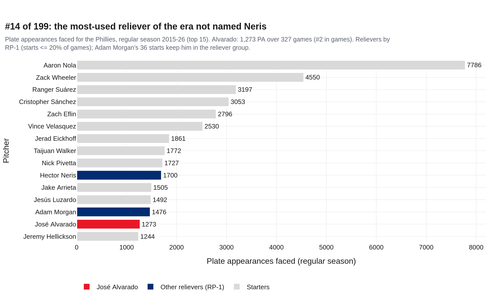
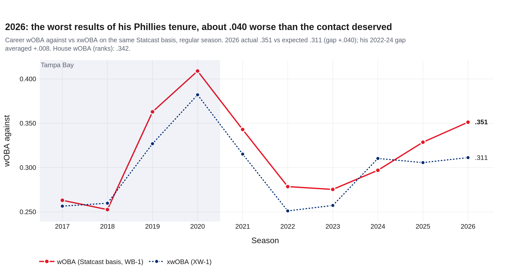
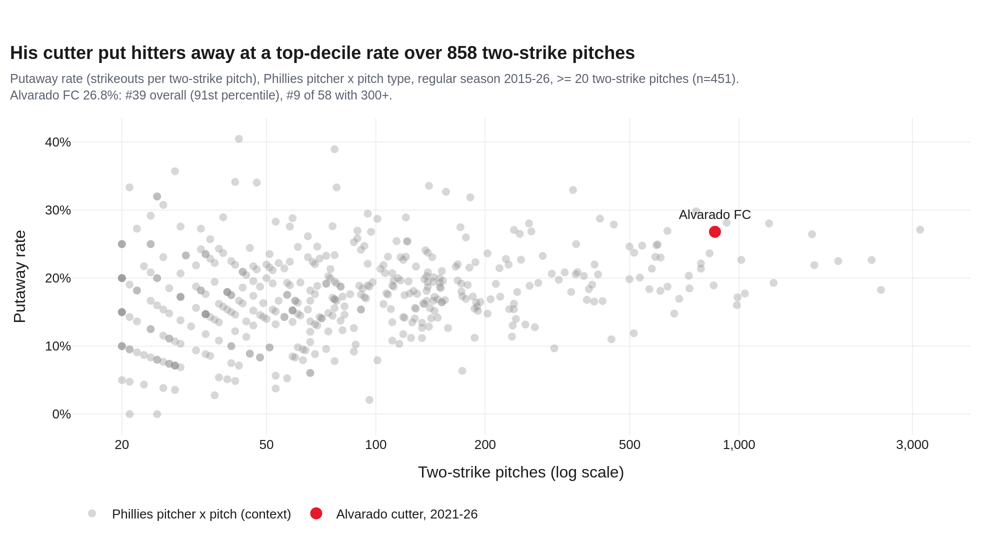
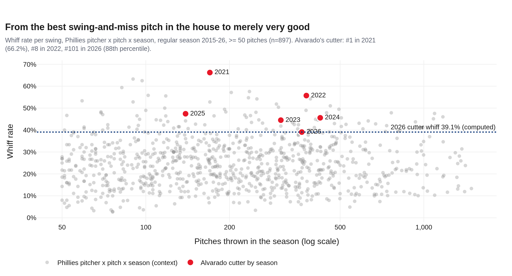
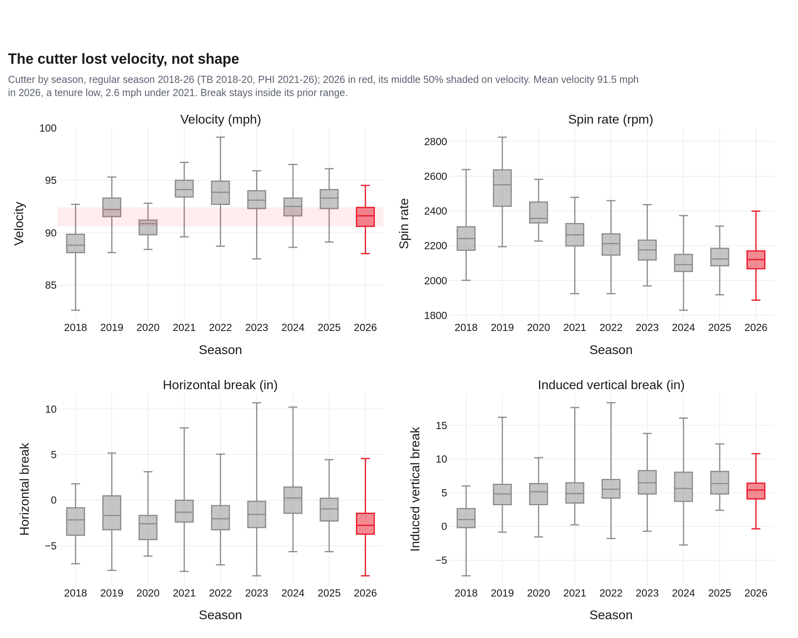
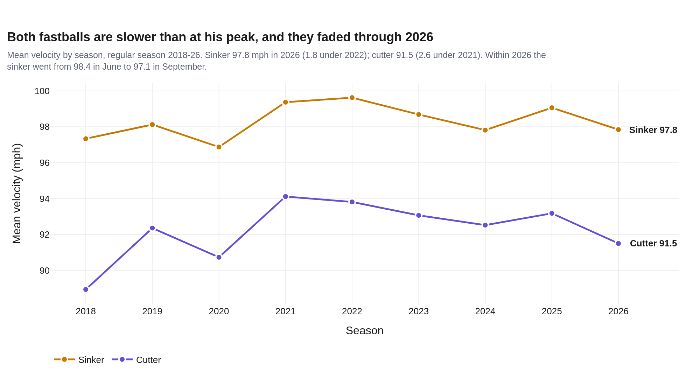
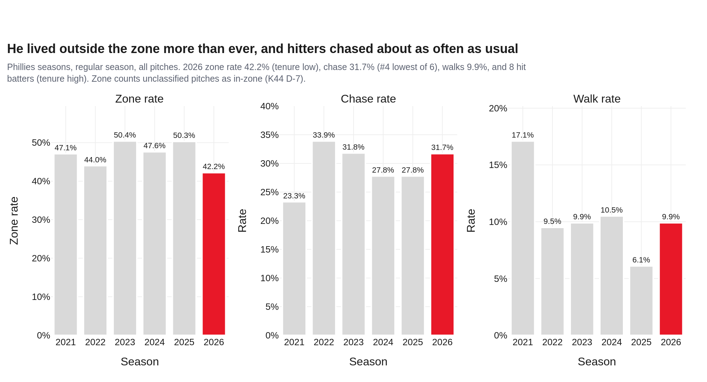
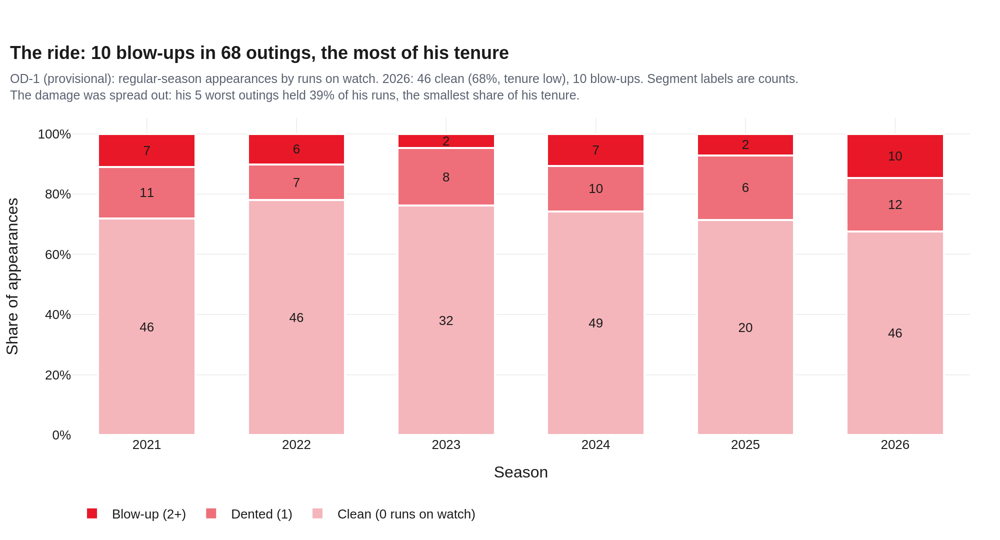
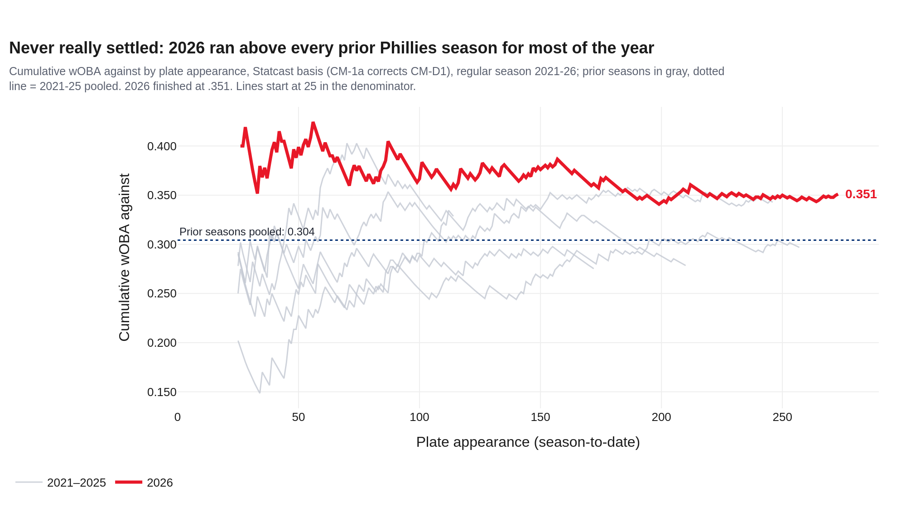
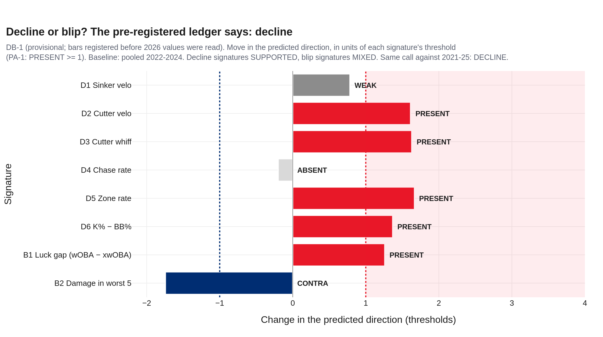

# The Full Ride — José Alvarado, 2026
### Season recap and Phillies tenure, 2021–26 · LHP reliever · Philadelphia Phillies · 68 games in 2026 · data through 2026-10-01

**Prepared for:** Front office, pitching department, bullpen staff · José Alvarado

**Arsenal (2026):** Sinker 62% (97.8 mph) · Cutter 32% (91.5 mph) · Curveball 3% (84.9 mph) · 4-Seam Fastball 2% (97.2 mph)

**Governance:** Use Case #53 (`uc-pps-037`) · build `dp_uc53` v1.0.0 · kernel `dp_uc53_kernel.py` imports `dp_uc52_kernel.py` (sha256 `3667f802…`) and the house `cumulative_metric.py` (`a2888740…`). New objects (OD-1, DB-1) are provisional; DB-1 was registered before any 2026 rate was read. Independently verified; see `05_quality_certification.md`.

**Companion:** `dp_uc53_alvarado_2026_dashboard.html`, the same story in 7 chapters.

> **Read this first: data window, sources, carry-ins.**
>
> - **Entity lock:** MLBAM 621237 with the pitching role, never a name filter (ENT-1: 9 rows in the 2018 log carry his id under a Phillies batter's name). Regular season for every rate; 53 spring pitches excluded; postseason only in the tenure ledger. The 2026 log holds 1,145 rows: 1,129 pitches plus 16 automatic balls/strikes with no pitch (AB-1).
> - **Sources:** Phillies logs 2021–26 plus `alvarado.parquet` (Tampa Bay 2017–20, used only for velocity and shape trends).
> - **“House” ranks and percentiles** are Phillies pitcher-seasons 2015–26 (relievers by RP-1: starts ≤ 20% of games). **Not MLB-wide.**
> - **Two wOBA bases:** house wOBA (FanGraphs weights) drives ranks; xwOBA is compared only with Statcast-basis wOBA (WB-1). In 2026 they read .342 and .351.
> - **“Runs on watch”** = runs scored during the plate appearances he threw (house `runs_created`). Not ERA.
> - **Carry-ins, reported and never computed on:** 2026 club option exercised, $9M (CBS News, Nov 2025) · free agent after 2026 (NBC Sports Philadelphia, 2026-10-02) · 80-game PED suspension announced 2025-05-18 (6abc) · optioned to Triple-A, May 2022 (SI) · IL, reinstated 2023-06-09 (MLB.com) · role reduced mid-2026 (MLB.com, 2026-07-04) · 5.86 ERA in 68 G (NBC) · “Mr. Punchie” and the Cotham cutter (client).
> - **No medical inference.** The log shows velocity and workload; it does not show an injury or the effect of the 2025 suspension.

## 1 · Bottom line
1. **He was a load-bearing reliever for half a decade.** 1,273 plate appearances faced is #14 among 199 Phillies pitchers since 2015 and #3 among relievers; his 327 games are #2. 2022 and 2023 (.258 and .259 wOBA) ranked #9 and #10 of 104 Phillies relief seasons since 2015.
2. **2026 was the worst season of his tenure.** .342 wOBA against (house) and 0.53 runs on watch per game, both tenure worsts; 20th percentile among 104 Phillies relief seasons. 10 of 68 outings were blow-ups (2+ runs), the most he has had.
3. **Part of it was luck, and the luck ran out.** Hitters out-hit their contact by .040 (wOBA .351 vs xwOBA .311, same basis), and his hard-hit rate (31.7%) was a tenure low. But from August his expected numbers caught up (xwOBA .344 and .347), as the sinker faded from 98.4 to 97.1 mph.
4. **The stuff declined.** The cutter averaged 91.5 mph (tenure low), and its whiff rate fell to 39.1% (#101 in the house, from #1 in 2021). His zone rate (42.2%) was the lowest of his tenure.
5. **Verdict: move on.** 4 of 6 pre-registered decline signatures are PRESENT; the blip case is MIXED. The same call holds against a 2021–25 baseline.

## 2 · Five-plus years in red pinstripes

Since 2015, only Hector Neris has faced more batters out of the Phillies bullpen with no starts (Adam Morgan's 1,476 PA include 36 starts). Over 327 regular-season games Alvarado allowed a .299 wOBA and .666 OPS and struck out 378 (29.7%). His peak, 2022–23, struck out 38.0% and walked 9.7%. The October ledger is separate: 2022 12 G, 51 PA, 14 K; 2023 8 G, 32 PA, 6 K; 2024 1 G, 5 PA, 1 K.

*Receipt: out/dp_uc53_house_pa_leaderboard.csv · claim asserted before render*

| Season | G | PA | wOBA (house) | wOBA (Statcast) | xwOBA | K% | BB% | Whiff | Runs on watch / G | Clean outings | House RP pct |
|---|---|---|---|---|---|---|---|---|---|---|---|
| 2021 | 64 | 246 | .322 | .343 | .315 | 27.6% | 17.1% | 33.2% | 0.41 | 72% | 35th |
| 2022 | 59 | 210 | .258 | .278 | .251 | 38.6% | 9.5% | 38.4% | 0.41 | 78% | 91st |
| 2023 | 42 | 172 | .259 | .275 | .257 | 37.2% | 9.9% | 33.5% | 0.29 | 76% | 88th |
| 2024 | 66 | 257 | .288 | .297 | .310 | 24.5% | 10.5% | 28.4% | 0.41 | 74% | 69th |
| 2025 | 28 | 114 | .305 | .329 | .306 | 28.1% | 6.1% | 24.3% | 0.39 | 71% | 52nd |
| **2026** | 68 | 274 | .342 | .351 | .311 | 25.5% | 9.9% | 27.0% | 0.53 | 68% | 20th |

*House RP percentile = wOBA allowed among 104 Phillies relief seasons 2015-26 (100+ PA; higher is better).*

## 3 · 2026 against his own standard

Every results line was his worst as a Phillie: .342 wOBA (house), 0.53 runs on watch per game, K–BB 15.7% (#3 lowest of 6). Expected stats were kinder, .311 xwOBA against a .351 same-basis actual, a .040 gap; in 2022–24 the gap averaged .008. Hitters made weak contact: 31.7% hard-hit (tenure low), 4.3% barrels. Among 8 Phillies relievers with 100+ PA in 2026, his wOBA ranked #7.

*Receipt: out/dp_uc53_career_by_year.csv · claim asserted before render*

## 4 · The cutter: still very good, no longer the best

Caleb Cotham's cutter (carry-in CI-8) is the pitch that made him. Over his tenure it put hitters away on 26.8% of 858 two-strike pitches, #9 of 58 Phillies pitch types with 300+ two-strike pitches. In 2021 its 66.2% whiff rate was #1 of 897 Phillies pitcher-pitch-seasons. In 2026 it fell to 39.1% (#101) and its two-strike putaway rate to 19.1%, his lowest on the pitch as a Phillie. The shape held; the velocity did not (91.5 mph, 2.6 under 2021).

*Receipt: out/dp_uc53_house_putaway_pitcher_pitch.csv · claim asserted before render*

*Receipt: out/dp_uc53_house_whiff_pitcher_pitch_season.csv · claim asserted before render*

*Receipt: out/dp_uc53_fc_si_pitches.csv · claim asserted before render*

## 5 · The arm: slower, and fading late

The sinker averaged 97.8 mph, 1.8 under 2022. More telling is the season's shape: through June both fastballs held (98.4 and 92.4 mph), then slid to 97.1 and 90.8 by September, while walks rose to 17.8% in August and 14.3% in September. The log shows the fade; it cannot say why.

*Receipt: out/dp_uc53_pitch_types_by_year.csv · claim asserted before render*

| Month | G | PA | wOBA (house) | xwOBA | K% | BB% | Sinker mph | Cutter mph |
|---|---|---|---|---|---|---|---|---|
| Mar-Apr | 14 | 55 | .369 | .303 | 21.8% | 9.1% | 98.2 | 91.6 |
| May | 11 | 42 | .339 | .281 | 33.3% | 2.4% | 98.1 | 91.9 |
| Jun | 11 | 48 | .356 | .296 | 31.2% | 6.2% | 98.4 | 92.4 |
| Jul | 10 | 42 | .307 | .299 | 28.6% | 9.5% | 97.7 | 90.9 |
| Aug | 11 | 45 | .333 | .344 | 17.8% | 17.8% | 97.4 | 90.7 |
| Sep | 11 | 42 | .342 | .347 | 21.4% | 14.3% | 97.1 | 90.8 |

## 6 · Command: outside the zone, into the bats

He threw 42.2% of his pitches in the zone by the house measure (41.4% counting only pitches actually thrown; AB-1), the lowest of his tenure either way, and hit 8 batters, the most. Hitters still chased 31.7%, close to his 2022–24 rate (30.9%), so the problem was not that batters stopped expanding. It was the sinker: 52.2% in the zone (from 60.8% in 2024) and a .374 wOBA when it ended a PA.

*Receipt: out/dp_uc53_career_by_year.csv · claim asserted before render*

## 7 · The ride: inconsistency, measured

46 of 68 outings were clean, 68%, the lowest share of his tenure, and 10 were blow-ups. The damage was not a few disasters: his five worst outings held 39% of his 36 runs on watch, the smallest share of any Phillies season (22 runs came in the other 63). Season to date, 2026 sat above every prior Phillies season at 75% of its plate appearances and never came down to his pooled 2021–25 level.

*Receipt: out/dp_uc53_outing_bands_by_year.csv · claim asserted before render*

*Receipt: out/dp_uc53_cumulative_woba.csv · claim asserted before render*

## 8 · Move on, or a blip?

Before reading a single 2026 rate, the organization wrote down eight signatures: six that a declining reliever shows and two that an unlucky one shows, each with a bar, scored by the house PA-1 rule against his pooled 2022–24 seasons. The roll-up: decline **SUPPORTED**, blip **MIXED**, call **DECLINE**. Against a 2021–25 baseline: **DECLINE**.

*Receipt: out/dp_uc53_db1_ledger.csv · claim asserted before render*

| # | Signature | Registered bar | 2022-24 | 2026 | PA-1 verdict |
|---|---|---|---|---|---|
| D1 | Sinker velocity (mph) (decline) | −1.0 mph | 98.6 | 97.8 | **WEAK** |
| D2 | Cutter velocity (mph) (decline) | −1.0 mph | 93.1 | 91.5 | **PRESENT** |
| D3 | Cutter whiff rate (decline) | −6 pts | 48.9% | 39.1% | **PRESENT** |
| D4 | Chase rate (all pitches) (decline) | −4 pts | 30.9% | 31.7% | **ABSENT** |
| D5 | Zone rate (all pitches) (decline) | −3 pts | 47.2% | 42.2% | **PRESENT** |
| D6 | K% minus BB% (decline) | −5 pts | 22.5% | 15.7% | **PRESENT** |
| B1 | wOBA minus xwOBA, same basis (bad luck) (blip) | +.025 | .008 | .040 | **PRESENT** |
| B2 | Share of runs on watch in his 5 worst outings (blip) | +10 pts | 56.3% | 38.9% | **CONTRA** |

**The case for moving on**
- Cutter velocity is down 1.6 mph on his 2022–24 level and its whiff rate is down 9.8 pts. That is the pitch that made him elite, and both are tenure lows.
- The zone rate fell 5.0 pts and K–BB fell 6.8 pts. Fewer strikes and fewer punchouts is the reliever-decline signature.
- The luck story fades late: from August his xwOBA (.344, .347) matched his results, and his velocity was at its season low.
- Every rate here is regular season with a pinned anchor. The call does not depend on the baseline: 2021–25 gives the same verdict.
- He enters free agency at 31, coming off a $9M option year (carry-ins CI-1, CI-2). The stuff trend points the wrong way for the price of high-leverage innings.

**The case for one more year**
- Contact was soft: 31.7% hard-hit (tenure low) and 4.3% barrels. The .040 wOBA-over-xwOBA gap is 5× his 2022–24 norm (.008).
- Hitters chased as much as ever (31.7%), and the cutter is still 88th-percentile for whiffs in the house.
- In April–June his expected numbers ran well ahead of his results (xwOBA .303, .281, .296 against house wOBA .369, .339, .356), the case MLB.com made in July (CI-6).
- He still threw 97.8 mph sinkers. A one-year deal at a lower price buys a lottery ticket on the 2025 shape (47.4% cutter whiff in 28 games).

> **The ledger favors moving on.** The blip evidence is real, but it is about balls in play. The decline evidence is about the arm and the strike zone, and it got worse as the season went on. If he returns, it should be on a short, cheap deal in a lower-leverage role, not in the late-inning bridge role he opened 2026 in (CI-6).

## 9 · Your notebook, graded

Each claim was reproduced with your own frame (`pps`, all game types, by name) and functions first, then restated on the governed frame. Claims are graded, never overwritten.

| # | Your claim | Your method | Governed value | Verdict |
|---|---|---|---|---|
| HP-01 | 14th-most PA for the Phillies since 2015; only Neris (full-time RP) has more | #14 (1374 PA, all game types) | #14 of 199 (1273 PA, regular season); RP-1t relievers above: Neris, Hector (1700, 0 starts), Morgan, Adam (1476, 36 starts) | **Supported (one nuance)** |
| HP-02 | .300 wOBA, .668 OPS, 399 strikeouts as a Phillie | 0.302 / 0.675 / 401 K | 0.299 / 0.666 / 378 K (regular season) | **Supported (frame restated)** |
| HP-03 | Best seasons 2022 and 2023; 2023 excellent; 'must have missed time with injury' | lowest wOBA: [2023, 2022] (0.259, 0.272) | 2022 0.258, 2023 0.259 (tenure ranks 1-2); 2023 = 42 games | **Supported; injury not inferred** |
| HP-04 | 2022-23: ~35% K, <10% BB, BA just above .200 | K 35.5% / BB 9.5% / BA 0.203 | K 38.0% / BB 9.7% (regular season) | **Supported (understated on the regular season)** |
| HP-05 | Cutter: 28% zone, 38% chase (~1,400 OOZ), ~52% K, 48% whiff, 26% putaway | zone 27.9%, chase 37.8% (1381 OOZ), K 51.4%, whiff 48.0%, putaway 26.1% | zone 27.8%, chase 38.1% (1285 OOZ), K 52.8%, whiff 48.3%, putaway 26.8% (regular season) | **Supported** |
| HP-06 | Cutter putaway is elite among Phillies pitcher x pitch combos (>=20 two-strike pitches) | 26.1%, #44 of 452 | 26.8%, #39 of 451 (91th pct) on 858 two-strike pitches | **Supported (top decile, not top)** |
| HP-07 | Cutter velocity trending down | 2021: 94.1 -> 2022: 93.8 -> 2023: 93.3 -> 2024: 92.5 -> 2025: 93.3 -> 2026: 91.6 | 2026 mean 91.5 mph, tenure low; peak 94.1 (2021) | **Supported** |
| HP-08 | 2026 cutter whiff 'fell off a cliff'; hline drawn at 0.39 | 2026 0.394 (hline hard-coded 0.39) | 2026 0.391, down from 0.474 (2025) and 0.557 (2022) | **Supported; DEF-1 hard-code happens to be right** |
| HP-09 | Cutter went from among the most elite swing-and-miss pitches to 'just very good' | 2021 rank 1, 2026 rank 97 of 901 | 2021 #1, 2022 #8, 2026 #101 of 897 (88th pct) | **Supported** |
| HP-10 | 2026 'remarkably inconsistent, sometimes reliable' (cumulative wOBA-against chart) | 2026 final 0.360 (module default) | 2026 final 0.351 (CM-1a, = WB-1); clean outings 46/68, blow-ups 10 | **Supported (chart restated: CM-D1)** |

### Candid caveats
- Relief samples are small: 274 PA in 2026; monthly cells are 42–55 PA. Read direction, not decimals.
- House ranks are Phillies pitcher-seasons 2015–26, not MLB-wide.
- OD-1 and DB-1 are provisional (first use). DB-1's bars are registered in 03 §2; changing one after publication is a breaking change.
- DB-1's B2 signature (damage concentration) came out CONTRA. That is evidence against the 'a few bad outings' story, not a missing value.
- The 2025 season (28 games) sits between an 80-game suspension and the end of the year; it is excluded from the DB-1 baseline and kept in the sensitivity run.
- CM-D1: the house cumulative module's default wOBA counts woba_value on intentional walks and sac bunts. F9 uses the corrected spec (CM-1a); your original chart ran high.
- AB-1: the 2026 log carries 16 automatic balls/strikes with no pitch; the house zone rate counts them in-zone (K44 D-7), so the 2026 zone decline is understated, not overstated.
- Contract, age and role facts are carry-ins from published reporting, labelled where used and never computed on.
