# Chase Shugart | 2026 | A Solid Middle Reliever Who Rebuilt His Plan Against Lefties

### UC #66 · `uc-pps-042` · `dp_uc66` v1.0.0 · Phillies Pitching · prepared for Kellen Short · house log anchor 2026-10-01

> **Data window.** Regular season 2026 only: **871 pitches, 223 PA, 46 outings**
> (2026-04-14 – 2026-09-26), MLBAM 663767. Your notebook's `pps` frame reconciles exactly (.430 SLG, 10.0% barrel rate);
> the house projection also carries 73 spring-training pitches, which are excluded everywhere (FR-1).
> Relievers live on small samples: every split below prints its PA, and anything under ~30 PA is directional only.

## Bottom line
- **A solid, roughly median-plus relief season.** .312 wOBA (56th pct) on .300 xwOBA (65th pct) against
  114 Phillies RHP relief seasons since 2015. Strikeouts (26.5%, 71st pct) and soft-ish contact carried it; **barrels
  (10.0%, 18th pct) and a low chase rate (25.7%, 21st pct) are the leaks.**
- **Your platoon read holds, 6 for 6.** Even with a hair of reverse (wOBA .309 vs LHB, .315 vs RHB). That is
  unusual for a righty reliever: the typical one is .028 of wOBA worse against lefties, and only 35% run reverse.
- **The cutter is the hinge.** It is a lefty pitch (.289 wOBA, RV/100 +1.2) and a righty
  liability (.439, -1.6), and against righties it lives over the middle of the plate.
  The sinker plays to both hands and finished 51% of his strikeouts.
- **The real mix change was against lefties, not righties.** The sweeper went from 25% of April pitches to lefties to
  4% in September, replaced by changeups and cutters. Against righties the mix barely moved.
- **June was contact, not command; the second stint was about getting ahead.** June's .441 wOBA came with his highest barrel rate
  and a zone rate tied for his best. After the July recall his first-pitch strike rate rose 10 points and wOBA fell
  90 points — walks did not improve.
- **Role: a middle reliever, used late but rarely close.** 6 of 46 outings were late & close; he entered with
  the Phillies behind 30 times. Of your 12 claims, 8 are supported, 3 partly, 1 not.

## How the organization calibrated him
You delegated the comparison set. The org chose **righty relievers**, not all righties and not "middle relievers" as a population:

| Set | What it is | Used for |
|---|---|---|
| **CS-A** Phillies RHP relief seasons | regular season 2015–26, RHP, reliever (starts ≤ 20% of games), ≥ 150 pitches — **114 seasons** | every season percentile (F1, F2, F6) |
| **CS-B** 2026 Phillies bullpen | 2026 relievers, either hand, ≥ 150 pitches — **12 others** | role and leverage (F9) |
| **CS-C** pitch × hand cells | CS-A pitchers' pitch type × batter hand seasons, ≥ 50 pitches | the pitch scorecard (F8) |
| His own history | **not used** — the house log holds only 77 scattered MLB pitches of his from 2025 | disclosed, no comparison drawn |

All-RHP would mix in starters (times through the order, pitch counts); a league-wide pool would have to come from `nphl`, which is a
hand-picked opponent set, not a sample. "Middle reliever" is a usage role, so it is answered inside the 2026 bullpen by entry state (§8).

## 1 · The season at a glance
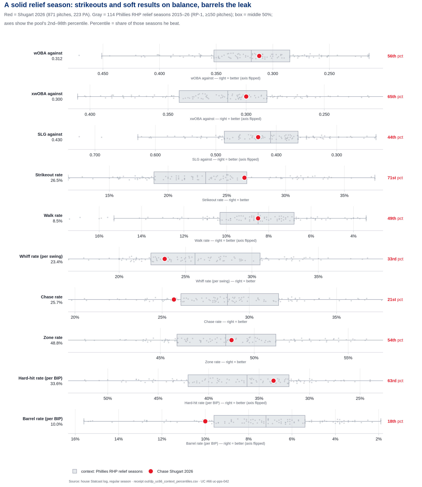

*F1. Every row is on its own scale and reads right = better. Gray = 114 Phillies RHP relief seasons; red = Shugart 2026.*

| | wOBA | xwOBA | SLG | K% | BB% | Whiff% | Chase% | Zone% | Hard-hit% | Barrel% |
|---|---|---|---|---|---|---|---|---|---|---|
| Shugart 2026 | .312 | .300 | .430 | 26.5% | 8.5% | 23.4% | 25.7% | 48.8% | 33.6% | 10.0% |
| CS-A median | .319 | .312 | .409 | 23.2% | 8.5% | 25.7% | 28.7% | 48.5% | 36.2% | 7.2% |
| Percentile | 56th | 65th | 44th | 71st | 49th | 33rd | 21st | 54th | 63rd | 18th |

The shape is a pitcher who gets strikeouts without elite swing-and-miss (whiff 33rd pct) — the putaway comes from the sinker
(§5) — and who keeps hard contact down overall (63rd pct) but gives up a high share of *barrels* when it does go wrong:
14 barrels on 140 balls in play, 10 home runs. Your ".430 SLG, fairly average, maybe a touch high" is
exactly right (44th pct), and "10% barrel rate is high" is right (18th pct).

## 2 · Platoon: even, a hair reverse
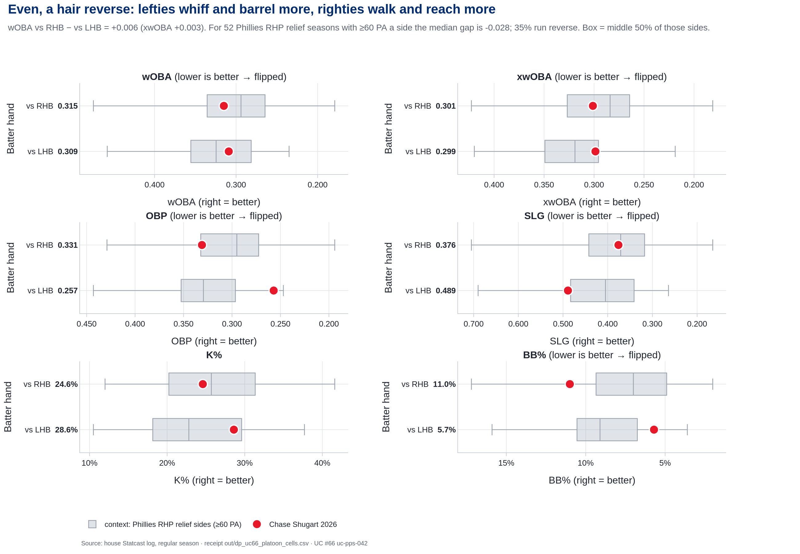

*F2. Each metric on its own scale, right = better. Gray boxes = middle 50% of Phillies RHP relief seasons on that side (≥ 60 PA).*

| vs | PA | BA | OBP | SLG | wOBA | xwOBA | K% | BB% | Whiff% | Barrel% |
|---|---|---|---|---|---|---|---|---|---|---|
| LHB | 105 | .207 | .257 | .489 | .309 | .299 | 28.6% | 5.7% | 24.3% | 13.6% |
| RHB | 118 | .238 | .331 | .376 | .315 | .301 | 24.6% | 11.0% | 22.5% | 6.8% |

Every leg of your read holds: lefties struck out more, walked less, whiffed more and slugged more; righties hit for average, reached base
and walked more. The context is what makes it interesting — a righty reliever who is *even* against lefties is already doing something
most don't. Expected numbers agree (xwOBA .299 vs .301), so this is not luck in one direction.

## 3 · The arsenal: pitch plot
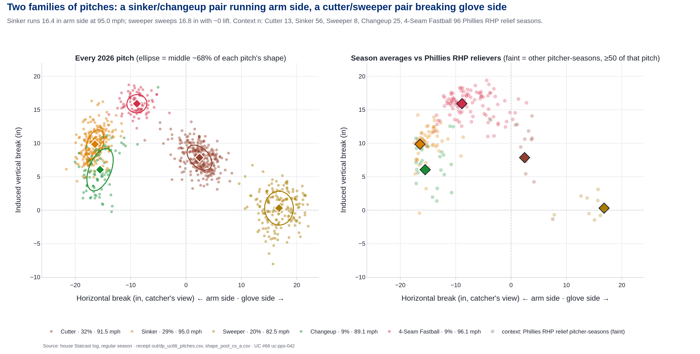

*F3. Left: every pitch, with each pitch type’s middle ~68% shape (ellipse) and mean (diamond). Right: his season means against Phillies RHP relief pitcher-seasons.*

| Pitch | Share | vs LHB | vs RHB | Velo | IVB (in) | HB (in) | RV/100 |
|---|---|---|---|---|---|---|---|
| Cutter | 32% | 33% | 31% | 91.5 | 7.9 | +2.4 | -0.2 |
| Sinker | 29% | 19% | 38% | 95.0 | 9.8 | -16.4 | +3.4 |
| Sweeper | 20% | 15% | 25% | 82.5 | 0.3 | +16.8 | -2.9 |
| Changeup | 9% | 18% | 1% | 89.1 | 6.0 | -15.5 | -2.4 |
| 4-Seam Fastball | 9% | 14% | 5% | 96.1 | 15.9 | -8.9 | -1.6 |

Two families: a **sinker/changeup** pair running 16+ inches arm side, and a **cutter/sweeper** pair
breaking glove side. In F3's right panel the sinker (95.0 mph) sits toward the heavy-run edge of the Phillies RHP relief sinker seasons; the sweeper
(17 in of sweep, ~0 lift) is a true sweeper; the cutter carries 7.9 in of lift at
91.5 mph. On your scratch subtitle: the cutter is not an outlier on horizontal movement (+2.4 in)
— its separation from the sinker is the point, about 19 inches of horizontal break between the two.

## 4 · Pitch map
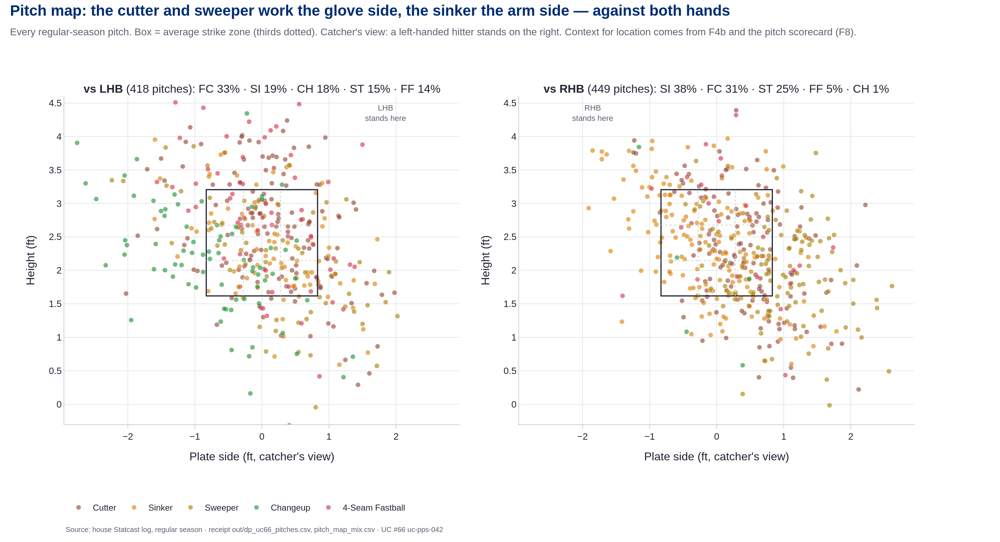

*F4a. Your pitch map, rebuilt: every pitch by batter hand (catcher’s view), usage in the panel titles.*

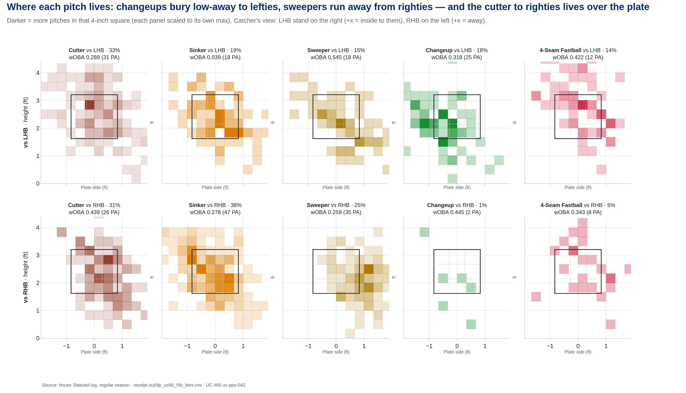

*F4b. Where each pitch lives: 4-inch density squares by pitch × hand, each panel scaled to its own maximum.*

The density view shows what the average-location bubble hid. Against **lefties**, the changeup is buried low and away and the cutter is
spread across the zone, with 42% of cutters on the inner third or further in. Against **righties**, the
sweeper starts on the plate and runs off it (only 3% on the inner third), the sinker works the middle and
arm side, and the **cutter clusters middle and middle-away** (12% on the righty's inner third) — the
location behind its .439 wOBA.

## 5 · What drives it: each pitch against each hand
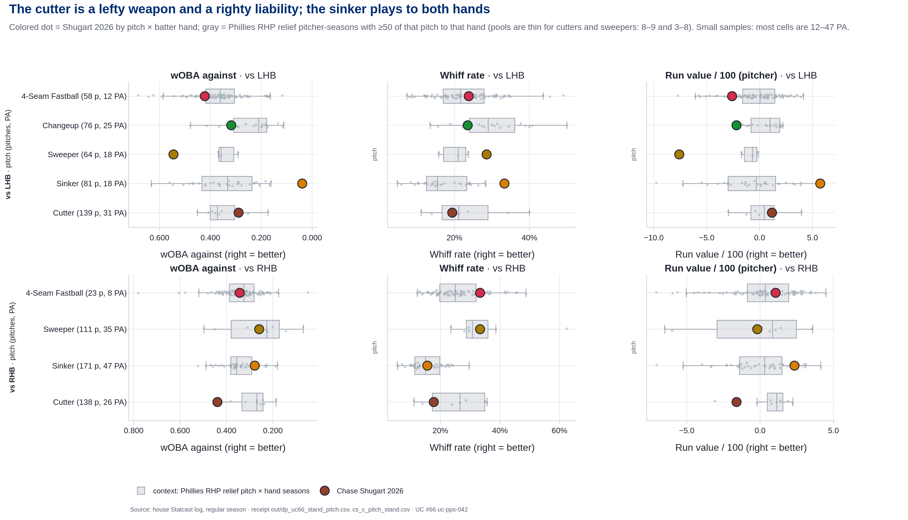

*F8. Colored dot = Shugart by pitch × hand; gray = Phillies RHP relief pitcher-seasons with ≥ 50 of that pitch to that hand. Right = better.*

| Pitch × hand | Pitches | PA | wOBA | xwOBA | Whiff% | RV/100 | wOBA pct in CS-C (n) |
|---|---|---|---|---|---|---|---|
| Cutter vs LHB | 139 | 31 | .289 | .303 | 19.4% | +1.2 | 75th (8) |
| Sinker vs LHB | 81 | 18 | .039 | .217 | 33.3% | +5.7 | 100th (32) |
| Sweeper vs LHB | 64 | 18 | .545 | .342 | 28.6% | -7.6 | 0th (3) |
| Changeup vs LHB | 76 | 25 | .318 | .208 | 23.5% | -2.2 | 25th (20) |
| 4-Seam Fastball vs LHB | 58 | 12 | .422 | .533 | 23.8% | -2.6 | 24th (75) |
| Cutter vs RHB | 138 | 26 | .439 | .407 | 17.8% | -1.6 | 11th (9) |
| Sinker vs RHB | 171 | 47 | .278 | .305 | 15.6% | +2.3 | 83rd (43) |
| Sweeper vs RHB | 111 | 35 | .259 | .217 | 33.3% | -0.2 | 37th (8) |
| 4-Seam Fastball vs RHB | 23 | 8 | .343 | .342 | 33.3% | +1.1 | — |

- **Sinker vs lefties: real, and tiny.** .039 wOBA on 18 PA beats every one of
  32 Phillies RHP relief sinker-vs-lefty seasons, with a 33% whiff rate
  (CS-C median 15%). xwOBA (.217) says the contact deserved more — atypical, yes; repeatable at .039, no.
- **Sinker vs righties** is the workhorse: 171 pitches, .278 wOBA, RV/100 +2.3.
  It finished 19 of his 29 strikeouts of righties.
- **Sweeper vs lefties was the worst cell on the sheet** — .545 wOBA, 4 barrels on
  18 PA, RV/100 -7.6. That is the cell he walked away from (§6).
- **Cutter vs righties**: .439 wOBA, 45% hard-hit, 11th percentile
  of 9 Phillies RHP relief cutter-vs-righty seasons.

## 6 · How the mix moved: cumulative pitch usage
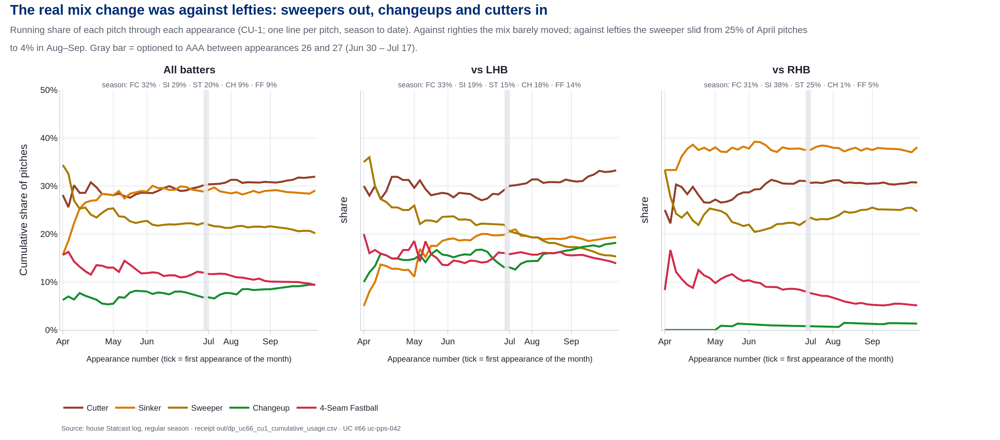

*F5. Running share of each pitch through every appearance, by batter hand. Gray bar = the option to AAA.*

Your monthly chart read "cutter usage took off at the end" and "backed off his sweeper" to righties. The cumulative view, split by hand,
puts the change somewhere else: **against lefties** the sweeper went from 25% (April) to 4%
(August) and 4% (September), and the changeup went from 15% to 30% /
27%. **Against righties** the sweeper was 30% in August and 22% in
September — a step back from August, not an abandonment (25% before September). Overall cutter share in
September was 38% vs 31% before: up, not taking off. The strong finish was real
(.152 wOBA in September, xwOBA .221, 35 PA), but the change that coincides with it is the
lefty plan, not the righty one.

## 7 · How the results moved
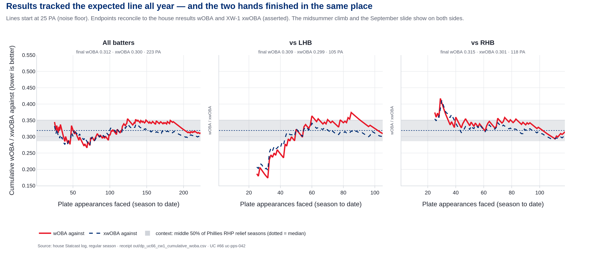

*F6. Cumulative wOBA (red) and xwOBA (dashed navy) against, by PA; band = middle 50% of Phillies RHP relief seasons.*

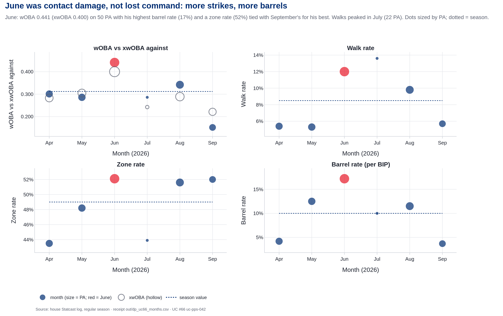

*F7. Month by month: dots sized by PA, never joined; dotted line = his season value.*

Results tracked expected all year: the actual line never ran far from the xwOBA line on either side, so the season's shape is not luck.
**June** is the outlier you flagged — .441 wOBA, .400 xwOBA on 50 PA — but it was not lost command:
June's zone rate (52.1% by the house rule; 51.1% on tracked pitches once a 4-pitch intentional walk is set aside) ties September's (52.0%) for his best and a 62% first-pitch strike rate, with **17%
barrels** on contact. Walks peaked in **July** (14% on 22 PA, just after the recall). The
read for 2027 is less "throw strikes" than "where the strikes go" (§4–5).

## 8 · Role: a middle reliever by usage
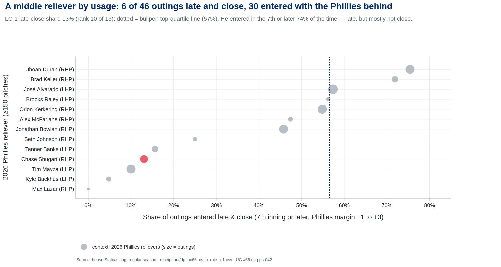

*F9. Share of outings entered late & close (7th+, Phillies margin −1 to +3) for every 2026 Phillies reliever with ≥ 150 pitches.*

6 of 46 outings (13%) were late & close — rank 10 of 13 in the
bullpen, far below the leverage arms (Duran, Keller, Alvarado, Kerkering all above 50%). He entered in the 7th or later 74%
of the time and with the Phillies **behind 30 times**. "Middle reliever" fits; "occasional flex into higher leverage" fits
the six late-and-close outings, but by the pre-registered bar (15–45% share) the flex was rarer than the phrase suggests.

## 9 · Stretch (S-1): command by stint
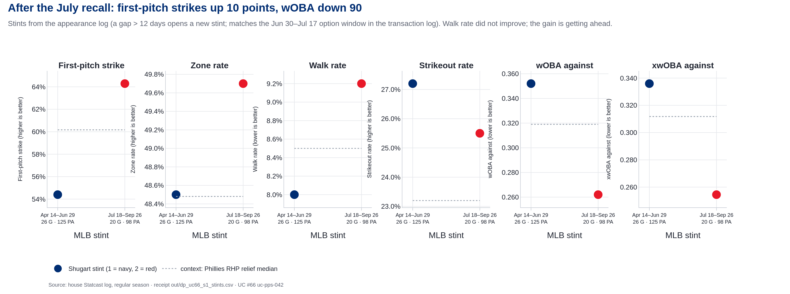

*S-1. The two MLB stints split by the Jun 30 – Jul 17 option. Dotted = Phillies RHP relief median.*

| Stint | Dates | G | PA | First-pitch strike | Zone | BB% | K% | wOBA | xwOBA |
|---|---|---|---|---|---|---|---|---|---|
| 1 | 2026-04-14 – 2026-06-29 | 26 | 125 | 54% | 48.5% | 8.0% | 27.2% | .352 | .336 |
| 2 | 2026-07-18 – 2026-09-26 | 20 | 98 | 64% | 49.7% | 9.2% | 25.5% | .262 | .254 |

Your thesis is "keep his command consistent". The stint split sharpens it: what changed after the recall was **getting ahead** (first-pitch
strikes 54% → 64%), not walks (8.0% → 9.2%) or zone rate. xwOBA fell with wOBA, so the
improvement is in the contact, not the bounces.

## 10 · Your claims, graded
Bars were filed in the BID (14:12 ET) before any number was computed. 8 SUPPORTED · 3 PARTLY · 1 NOT.

| # | Your claim | Verdict | Evidence |
|---|---|---|---|
| HP-01 | Mostly even leaning slightly reverse platoon splits | **SUPPORTED** | gap +0.006; xgap +0.003. wOBA vs LHB 0.309 / vs RHB 0.315; CS-A median gap -0.028 (n = 52; 35% of RHP relief seasons are reverse) |
| HP-02 | a solid year overall | **SUPPORTED** | wOBA 56th, xwOBA 65th. wOBA 0.312 vs CS-A median 0.319; xwOBA 0.300 vs 0.312; n = 114 |
| HP-03 | LHB: more K, fewer BB, more whiffs, more damage on contact; RHB: hit him more often, more walks, less slug | **SUPPORTED** | K% L>R Y, BB% L<R Y, whiff L>R Y, SLG L>R Y, BA R>L Y, OBP R>L Y. K% 28.6%/24.6%; BB% 5.7%/11.0%; whiff 24.3%/22.5%; SLG 0.489/0.376; BA 0.207/0.238; OBP 0.257/0.331 (L/R); barrel 13.6%/6.8% |
| HP-04 | cutter is a problem vs RHB; drives success vs LHB | **SUPPORTED** | RHB Y, LHB Y. FC vs RHB wOBA 0.439 (26 PA), RV/100 -1.6; vs LHB wOBA 0.289 (31 PA), RV/100 +1.2; CS-C FC x RHB wOBA pct 11 (n = 9) |
| HP-05 | cutter lets him own the inside part of the plate to LHB | **PARTLY** | 58/139 = 41.7%. FC to RHB on their inner third: 11.6% (he works it away from righties) |
| HP-06 | SI effective vs LHB; atypical | **SUPPORTED** | 100th of 32. wOBA 0.039 on 18 PA (81 pitches); xwOBA 0.217; whiff 33.3% (pct 100); CS-C median wOBA 0.332. Small sample: 18 PA |
| HP-07 | majority of his strikeouts came on his sinker | **SUPPORTED** | 30/59 = 50.8%. vs RHB 66% of K on SI; vs LHB 37% |
| HP-08 | June was bad and he likely lost some command | **PARTLY** | wOBA Y, command N. June wOBA 0.441 / xwOBA 0.400 on 50 PA; BB% 12.0% (July 13.6% higher); zone% 52.1% (house rule, counts a 4-pitch IBB in-zone; Sep 52.0%); hard-hit 37.9%, barrel 17.2% |
| HP-09 | cutter usage took off at the end; backed off the sweeper to RHB; coincided with a strong finish | **NOT** | FC N, ST N, finish Y. September: FC 38.4% vs 30.7% before (1.25x); ST to RHB 22.4% vs 25.1% (0.89x); wOBA 0.152 / xwOBA 0.221 on 35 PA |
| HP-10 | .430 SLG allowed ... fairly average, maybe a touch high | **SUPPORTED** | REC PASS (0.430); pct 44. CS-A median SLG 0.409; client frame incl. spring would print 0.422 (so the client's .430 is regular season) |
| HP-11 | His 10% barrel rate is high | **SUPPORTED** | REC PASS (10.0%); pct 18. 14 barrels on 140 BIP; CS-A median 7.2%; vs LHB 13.6%, vs RHB 6.8% |
| HP-12 | a middle reliever with the occasional flex into higher-leverage situations | **PARTLY** | share 13.0% (N), below p75 56.5% (Y). 6 of 46 outings late & close (rank 10 of 13 in the 2026 bullpen); entered 7th or later 74%; entered behind 30, ahead 14 |

Your recommendation — "focus on being sinker/sweeper to righties" — is not graded (it is a plan, not a claim), but the evidence backs
it: vs RHB the sinker (RV/100 +2.3) and sweeper (-0.2, 33%
whiff, .259 wOBA) both out-ran the cutter (-1.6, .439).

## 11 · What to watch in 2027
1. **Cutter location to righties.** It was thrown 138 times to righties and lives over the plate; either move it in on
   the hands or trade it for sinkers/sweepers to righties.
2. **Barrels.** 10.0% is an 18th-percentile rate; he survives on strikeouts and a low hard-hit rate. A season where the
   barrels stay and the strikeouts dip is the downside case.
3. **First-pitch strikes.** The second-stint number (64%) is the most actionable indicator in this file.
4. **The lefty plan.** Changeup + cutter with the sweeper shelved; the sinker-vs-lefty result (.039) will regress — watch its whiff rate, not its wOBA.

## Caveats
- **Sample.** 223 PA for the season; pitch × hand cells are 12–47 PA; September is 35 PA. Percentiles carry real noise.
- **Thin pools.** Only 9 Phillies RHP relief seasons threw ≥ 50 cutters to righties; 3 threw ≥ 50 sweepers to lefties.
- **No own history.** The house log has no usable pre-2026 Shugart; 2024–25 public lines are not carried in. The AAA tier (115 pitches, 7 outings) is supporting only and never blended.
- **House rules inherited.** wOBA uses FanGraphs weights over every PA (IBB counts as a PA, not a walk); whiff inner-join drops zero-whiff cells (DQ-13).
- **Automatic balls.** A 4-pitch intentional walk (Jun 22) has no pitch type or zone; the house chase function counts it in-zone (DQ-17). It is left out of usage and pitch-type cells.
- **LC-1** is an entry-state proxy for leverage; Statcast carries no leverage index.

## Method & receipts
Kernel `dp_uc66_kernel.py` imports `dp_uc64_kernel` (sha-pinned) and through it the house KPI chain (K44 `nresults`, `whiff_rate`, `chase_rate`,
`fpsr`, `putaway_rate`, `hard_hit_rate`, `pitch_mix`; K48 `rv100`, `house_percentile`; K49 CX-1; K50 XW-1; K51 BR-1; K52 RP-1; K63 outing ledger;
`cumulative_metric`). Build `dp_uc66_shugart_recap.py` → `out/dp_uc66_*` receipts; grades `dp_uc66_hp.py`; figures `dp_uc66_build_figs.py`
(V1–V7 machine audit + VZ-1…VZ-6); independent recompute `dp_uc66_verification.py`. DQ: 12 PASS / 5 WARN /
0 FAIL. Governance trail: `Agents for Data Products/data-products/uc-pps-042-shugart-2026-recap-001/`.
